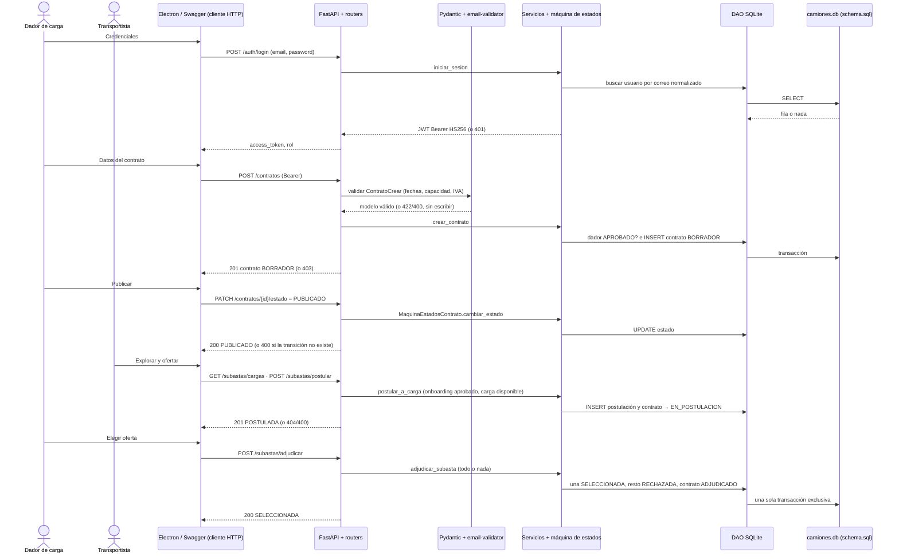

# Changelog — MansoViaje · Camiones Contratos

Formato basado en [Keep a Changelog](https://keepachangelog.com/es-ES/1.1.0/). Este documento reúne las notas de la entrega, la verificación del flujo principal (rúbrica 6 y apartado «Integración y verificación» del punto 7) y el cierre del paquete (rúbrica 7).

## [1.0.0] — Entrega Hito 3 · 2026-11-25

### Identificación del paquete

| Campo | Valor |
|---|---|
| Producto | MansoViaje — Camiones Contratos (API FastAPI + cliente Electron) |
| Versión | `1.0.0` (`package.json` y `frontend/package.json`) |
| Rama de la entrega | `RamaSS`, con `origin/Dev` integrado en `125ac1d` |
| Commit de referencia | SHA completo en `VERSION.txt` dentro de la distribución. Etiqueta prevista: `v1.0.0` |
| Repositorio | https://github.com/hamburgetestudent/Camiones_contratos |
| Entorno verificado | Windows 11, Python 3.14.8 (CI: Python 3.12), SQLite, Node 24 en CI |

### Distribución de escritorio

- Primer instalador integrado para Windows x64. El producto alcanza 1.0.0 con un flujo reproducible desde la publicación de una carga hasta la recuperación de la oferta. Los metadatos de FastAPI pasan de 0.1.4 a 1.0.0 para identificar el mismo producto. Se añade el endpoint de salud, conservando las operaciones de negocio.
- **Compatibilidad y actualización.** Instalación por usuario. La aplicación guarda su base en el perfil del usuario, fuera de la carpeta del programa. Al actualizar, conserva el directorio de datos. Para trasladar una base de desarrollo compatible, cierra ambas aplicaciones, conserva una copia de seguridad y copia el archivo a una carpeta de datos nueva antes de abrir la versión instalada con ese perfil. Inicia sesión de nuevo.
- **Limitaciones conocidas.** Entrega Windows x64 sin firma comercial. El puerto 8000 debe estar libre. Cada perfil tiene datos locales independientes. Los usuarios de demostración están destinados a una evaluación local.
- **Decisión y efecto.** El instalador NSIS permite al docente operar sin preparar runtimes. Electron inicia el backend PyInstaller en formato directorio, espera una respuesta de salud identificada y cierra el proceso mediante su entrada estándar. Esto suma peso y una construcción específica para Windows, pero permite verificar los dos subsistemas juntos. El ZIP de fuentes incluido facilita localizar y probar extensiones.
- **Ensayo desde fuentes limpias.** Electron 44 descarga su runtime bajo demanda. El primer build se detuvo al recopilar los avisos de Chromium. El script ahora ejecuta el instalador de runtime incluido en el lockfile antes de recopilar avisos.
- **Dependencias de desarrollo.** El diagnóstico de npm en el árbol de construcción informó 18 alertas transitivas (10 moderadas, 7 altas y 1 crítica). Queda revisar las cadenas afectadas y probar las actualizaciones de herramientas antes de la próxima distribución.
- **Reproducción.** Cada instalador lleva su commit y fuentes en `resources/entrega/`. El listado SHA-256 se genera después de construir el instalador. La consulta de CI para el SHA aparece en `VERSION.txt`. El registro de aceptación y la ficha externa se conservan junto al instalador.

### Agregado

- Capa **DAO** SQLite (`dao/`) para usuarios, onboarding, contratos y postulaciones; los servicios la reciben por inyección ([`services/dependencies.py`](services/dependencies.py)).
- Modularización de interfaces y dependencias de autenticación ([criterio 4](docs/criterio-4-modularizacion.md)).
- Revisión de la dependencia externa `email-validator` ([informe](docs/revision-dependencia-email-validator.md)) y rango acotado en `requirements.txt` (`>=2.2.0,<3`).
- Script de verificación del flujo integrado [`scripts/verificar_flujo_integrado.py`](scripts/verificar_flujo_integrado.py) (tres casos, 18 comprobaciones).
- Rediseño del frontend de escritorio y panel de administración ([detalle](docs/panel-administracion.md)).

### Cambiado

- Tres refactorizaciones con comportamiento conservado: decisión administrativa unificada, estado y faltantes del transportista, normalización del correo ([diagnóstico y mediciones](docs/hito3-intervenciones.md)).
- Validación de correo: de una regex a `email-validator.validate_email` con `check_deliverability=False` (rechaza `a..b@x.cl` o `.a@x.cl`, que la regex aceptaba).

### Registro histórico de la verificación de API previa al instalador

| Verificación | Comando | Resultado (2026-11-25) |
|---|---|---|
| Suite unittest | `python -m unittest discover -s tests -t .` | 222 pruebas, **OK** |
| Cobertura (líneas + ramas) | `coverage run -m unittest discover -s tests -t .` y `coverage report` | **93,3 %** total (`database`, `domain`, `routers`, `services`; configuración en [`.coveragerc`](.coveragerc)) |
| Linter | `ruff check .` | Sin hallazgos |
| Flujo integrado | `python scripts/verificar_flujo_integrado.py` | **18 de 18** comprobaciones OK |
| CI | [`.github/workflows/tests.yml`](.github/workflows/tests.yml) | Ejecuta ruff, pytest con cobertura (sube `coverage.xml` como artefacto) y typecheck del frontend en cada push a `main` y en cada pull request |

> Estas cifras pertenecen a la verificación anterior. Para la suite y la cobertura de la distribución, consulta los checks del SHA de VERSION.txt y el artefacto `cobertura` del job backend.

---

## Integración y verificación del flujo principal

### Diagrama del flujo

Flujo principal: un dador de carga publica un contrato, un transportista aprobado postula y el dador adjudica.

### Diagrama del script de verificación

Estructura de [`scripts/verificar_flujo_integrado.py`](scripts/verificar_flujo_integrado.py): crea una base temporal, ejecuta los tres casos en orden y registra cada comprobación.

```mermaid
flowchart TD
    A([Inicio: python scripts/verificar_flujo_integrado.py]) --> B[Crear directorio temporal<br/>SQLITE_DB_PATH = integracion.db]
    B --> C[Importar app FastAPI y inicializar_bd<br/>con semilla]
    C --> D[Crear TestClient]

    D --> E1

    subgraph C1 [Caso 1: datos válidos]
        direction TB
        E1[1.1 POST /auth/registro<br/>espera 201] --> E2[1.2 POST /auth/login dador<br/>espera token Bearer]
        E2 --> E3[1.3 POST /contratos<br/>espera 201, BORRADOR]
        E3 --> E4[1.4 PATCH estado a PUBLICADO<br/>espera 200]
        E4 --> E5[1.5 GET /subastas/cargas<br/>la carga aparece]
        E5 --> E6[1.6 Login transportista<br/>POST /subastas/postular<br/>espera 201, POSTULADA]
        E6 --> E7[1.7 POST /subastas/adjudicar<br/>espera 200, SELECCIONADA]
        E7 --> E8[1.8 GET /contratos/id<br/>espera ADJUDICADO]
    end

    E8 --> F0

    subgraph C2 [Caso 2: datos inválidos]
        direction TB
        F0[Contar usuarios y contratos<br/>antes] --> F1[2.1 Correo ana@@empresa.cl<br/>espera 422]
        F1 --> F2[2.2 neto + IVA ≠ total<br/>espera 400/422]
        F2 --> F3[2.3 peso > capacidad camión<br/>espera 400/422]
        F3 --> F4[2.4 Login con clave errónea<br/>espera 401]
        F4 --> F5[2.5 Contar después<br/>el estado no cambió]
    end

    F5 --> G1

    subgraph C3 [Caso 3: recurso ausente]
        direction TB
        G1[3.1 GET contrato inexistente<br/>espera 404] --> G2[3.2 Postular a carga inexistente<br/>espera 404]
        G2 --> G3[3.3 GET /contratos sin token<br/>espera 401/403]
        G3 --> G4[Cerrar cliente y borrar<br/>el archivo .db]
        G4 --> G5[3.4 Login con la BD eliminada<br/>espera 401, sin caída]
        G5 --> G6[3.5 La BD se recrea<br/>el archivo existe]
    end

    G6 --> H[Resumen: N/M comprobaciones OK]
    H --> I{¿Hay fallos?}
    I -- No --> J([Código de salida 0])
    I -- Sí --> K([Código de salida 1])
    J --> L[Limpiar directorio temporal]
    K --> L

    E1 -.-> R[(comprobar: registra cada paso<br/>en REGISTRO e imprime OK o FALLO)]
    F1 -.-> R
    G1 -.-> R
```

### Participantes

| Tipo | Elemento | Papel en el flujo |
|---|---|---|
| Módulos propios | `routers/`, `services/`, `domain/`, `dao/`, `database/` | Entrada HTTP, reglas de negocio, validación, acceso a datos, conexión y esquema |
| Módulo propio | `frontend/` (Electron + TypeScript) | Cliente de escritorio; consume la API por HTTP |
| Dependencias externas | FastAPI, uvicorn, Pydantic, `email-validator`, `python-dotenv` | Servidor, validación de esquemas y de correo (el detalle de `email-validator` está en su [informe](docs/revision-dependencia-email-validator.md)) |
| Recursos del entorno | `camiones.db` (o `SQLITE_DB_PATH`), `database/schema.sql`, `JWT_SECRET_KEY`, puerto 8000 | Persistencia, esquema, firma de tokens y red local |

### Datos que se intercambian

- **Cliente → API:** JSON con credenciales, contrato (`ContratoCrear`), postulación (`PostulacionCrear`) y adjudicación (`carga_id`, `postulacion_id`); token `Authorization: Bearer`.
- **API → cliente:** modelos de respuesta (`RespuestaLogin`, `ContratoModelo`, `PostulacionModelo`) o `{"detail": ...}` en errores.
- **Servicios ↔ DAO:** modelos de dominio y una conexión SQLite abierta, para combinar varios DAO en una transacción.

### Manejo de errores en las conexiones

| Conexión | Falla | Respuesta | Estado del sistema |
|---|---|---|---|
| Cliente → API | Sin token, token inválido o sesión cerrada | `401` con `WWW-Authenticate: Bearer` | Sin cambios |
| Cliente → API | Rol insuficiente o dador no aprobado | `403` | Sin cambios |
| API → Pydantic | Esquema o regla de negocio inválida | `422` / `400` con el detalle | No se escribe nada |
| API → servicios | Recurso inexistente | `404` | Sin cambios |
| API → servicios | Transición no permitida u operación inválida | `400` | Estado anterior conservado |
| Servicios → SQLite | Fallo dentro de una transacción (p. ej. adjudicación) | Excepción y *rollback* | «Todo o nada»: no queda estado a medias |
| Servicios → archivo `.db` | El archivo desaparece | `schema.sql` se reaplica al abrir la siguiente conexión (`_asegurar_esquema`) | Base nueva y vacía, el servidor sigue respondiendo |

### Los tres casos ejecutados

Entorno de todos los casos: Windows 11, Python 3.14.8, FastAPI `TestClient` sobre la aplicación real (`main.app`) y una base SQLite temporal inicializada con las cuentas semilla. No se simula ningún servicio propio ni externo. La salida completa se reproduce con `python scripts/verificar_flujo_integrado.py`.

#### Caso 1 · Datos válidos

| Paso | Esperado | Obtenido |
|---|---|---|
| 1.1 `POST /auth/registro` (`ana@empresa.cl`) | 201 | 201 ✅ |
| 1.2 `POST /auth/login` (dador aprobado) | 200 + token Bearer | token emitido ✅ |
| 1.3 `POST /contratos` | 201, `BORRADOR` | 201, `BORRADOR` ✅ |
| 1.4 `PATCH /contratos/{id}/estado` → `PUBLICADO` | 200, `PUBLICADO` | 200, `PUBLICADO` ✅ |
| 1.5 `GET /subastas/cargas` | la carga aparece | aparece ✅ |
| 1.6 `POST /subastas/postular` | 201, `POSTULADA` | 201, `POSTULADA` ✅ |
| 1.7 `POST /subastas/adjudicar` | 200, `SELECCIONADA` | 200, `SELECCIONADA` ✅ |
| 1.8 `GET /contratos/{id}` | `ADJUDICADO` | `ADJUDICADO` ✅ |

#### Caso 2 · Datos inválidos

| Paso | Esperado | Obtenido |
|---|---|---|
| 2.1 Registro con `ana@@empresa.cl` | 422 | 422 ✅ |
| 2.2 Contrato con neto + IVA ≠ total | 400 o 422 | 400/422 ✅ |
| 2.3 Contrato con peso mayor que la capacidad del camión | 400 o 422 | 400/422 ✅ |
| 2.4 Login con clave errónea | 401 | 401 ✅ |
| 2.5 Estado conservado | `usuarios=6`, `contratos=1` | `usuarios=6`, `contratos=1` ✅ |

#### Caso 3 · Recurso ausente

| Paso | Esperado | Obtenido |
|---|---|---|
| 3.1 `GET /contratos/{id inexistente}` | 404 | 404 ✅ |
| 3.2 `POST /subastas/postular` a una carga inexistente | 404 | 404 ✅ |
| 3.3 `GET /contratos` sin token | 401 o 403 | 401 ✅ |
| 3.4 Se elimina `integracion.db` en caliente y se hace login | 401, sin caída del servidor | 401 ✅ |
| 3.5 Después del paso anterior | el archivo se recrea con su esquema | existe de nuevo ✅ |

**Fallos corregidos durante la verificación:** el script se corrió varias veces hasta quedar en verde; los errores eran del propio script (conexiones de apoyo sin cerrar que en Windows impedían borrar el `.db`, y una tupla de registro mal indexada). No se encontraron fallos en el backend que bloquearan el flujo.

**Qué no se simuló y qué queda pendiente:** el cliente Electron no se ejecutó en esta verificación (solo la API, que es lo que consume). El flujo de aprobación KYC por el administrador se cubre con las cuentas semilla ya aprobadas y con las pruebas de `tests/onboarding/`, no con una llamada dentro del flujo de arriba.

---

## Paquete y cierre

### Cómo ejecutar la entrega (otro equipo)

El [README de la entrega](README.md#entrega-100-para-windows-x64) indica cómo instalar, publicar la carga, postular, consultar y reiniciar. El revisor registra sus observaciones en la [ficha externa](docs/revision-externa.md).

### Cómo extenderlo

La guía está en la sección «Cómo extender el proyecto» del [README](README.md#cómo-extender-el-proyecto).

### Decisiones

| Decisión | Motivo |
|---|---|
| Capa DAO con conexión inyectada | Permite que un servicio combine varios DAO en una transacción y garantiza la adjudicación «todo o nada» |
| `email-validator` en vez de regex, con `check_deliverability=False` | Reglas reales de correo sin depender de DNS ni de red |
| Rango `>=2.2.0,<3` para `email-validator` | Excluye la 2.1.0 retirada y bloquea saltos de versión mayor sin revisión |
| SQLite con esquema idempotente | Cero configuración para quien ejecuta la entrega; el archivo se recrea si falta |
| Verificación de integración sobre la API real y una base temporal | Prueba el flujo completo sin tocar `camiones.db` ni simular servicios |

### Evidencias

- Diagnóstico, tres refactorizaciones y mediciones: [docs/hito3-intervenciones.md](docs/hito3-intervenciones.md)
- Modularización: [docs/criterio-4-modularizacion.md](docs/criterio-4-modularizacion.md)
- Dependencia externa: [docs/revision-dependencia-email-validator.md](docs/revision-dependencia-email-validator.md)
- Contratos de diseño del servicio de usuarios: [docs/contrato-usuario-service.md](docs/contrato-usuario-service.md)
- Panel de administración: [docs/panel-administracion.md](docs/panel-administracion.md)
- Modelado UML: [docs/modelados/](docs/modelados/) (secuencia de «crear contrato» en [3-secuencia.md](docs/modelados/3-secuencia.md))
- Guía de pruebas: [tests/README.md](tests/README.md)

### Pendientes

1. **Revisión externa.** Entregar el instalador identificado por SHA-256 y recoger la ficha completada por otro equipo. Corregir y repetir cualquier paso que requiera ayuda.
2. **Distribución.** Confirmar el destino accesible al docente y obtener autorización para subir la etiqueta y publicar los archivos. Usar el mismo instalador verificado.
3. **Continuidad.** Evaluar otra arquitectura o firma del instalador si el laboratorio las requiere. La suite y la cobertura automática están en [Actions](.github/workflows/tests.yml). La aceptación del instalador se puede repetir con [el guion de Electron](frontend/tests/entrega.e2e.cjs).

---

## Historial anterior

- **2026-11-24** — Capa DAO para contratos, subastas, usuarios y onboarding; modularización del criterio 4; informe de `email-validator`.
- **2026-11-23** — Pruebas de caracterización y las tres refactorizaciones del Hito 3.
- **2026-11-22** — Rediseño del frontend, entrega final de la tercera entrega y tabla de evaluación.
- Historial completo: `git log` (más de 270 commits en el repositorio).