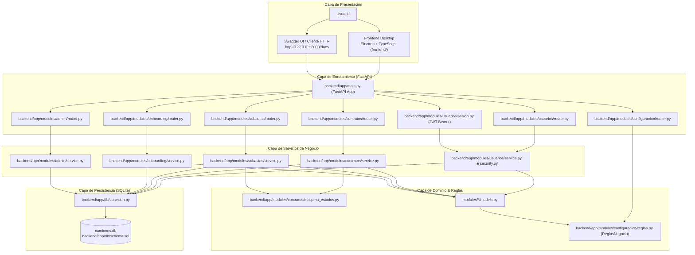

# MansoViaje — Camiones Contratos

Plataforma integral multiplataforma orientada a la centralización y digitalización de contratos de transporte terrestre de carga. Conecta a empresas generadoras de carga (**Dadores de Carga**) con **Transportistas** independientes o flotas de camioneros, cubriendo el registro y verificación documental (KYC), publicación de cargas, subastas/postulaciones, adjudicación y seguimiento del ciclo de vida del contrato.

La arquitectura separa claramente las responsabilidades entre cliente y servidor:

* **Frontend (`frontend/`):** Aplicación de escritorio desarrollada con **Electron** y **TypeScript**, con vistas por rol para autenticación, registro y operación comercial.
* **Backend (`backend/app/`, organizado por módulos de dominio):** API REST modular construida con **FastAPI** y **Pydantic**, lógica de negocio gobernada por una máquina de estados finitos y persistencia directa en **SQLite** (`camiones.db`).

### Enlaces Rápidos

* **Hito 3 · Intervenciones:** [Diagnóstico, tres refactorizaciones y pruebas (criterios 1 y 2)](docs/hito3-intervenciones.md)
* **Hito 3 · Modularización:** [Criterio 4: modularización de interfaces y dependencias](docs/criterio-4-modularizacion.md)
* **Hito 3 · Punto 6 (dependencia externa):** [Revisión de `email-validator`: utilidad, mantenimiento, licencia, riesgo y mitigación](docs/revision-dependencia-email-validator.md)
* **Modelado UML (Entrega 3):** [`docs/modelado/`](docs/modelado/) *(y carpeta de trabajo del equipo [`docs/modelados/`](docs/modelados/))*
* **Panel de administración:** [Navegación, bajas lógicas, auditoría y pruebas](docs/panel-administracion.md)
* **Reglas de Negocio:** [`REGLAS_DE_NEGOCIO.md`](REGLAS_DE_NEGOCIO.md)
* **Changelog, verificación del flujo y cierre de la entrega:** [`CHANGELOG.md`](CHANGELOG.md)
* **Guía de Pruebas y Cobertura:** [`backend/tests/README.md`](backend/tests/README.md)
* **Prototipo UI (Figma):** [Contratos camioneros centralizados](https://www.figma.com/design/leoA2Ejoi6cJi13esWBsXQ/Contratos_camioneros_centralizados?node-id=0-1&t=v76XFzFL7hSGl8TY-1)
* **Cronología de cambios e informes:** [Documento en Google Docs](https://docs.google.com/document/d/1p95pKZ2zpQuFnw19-MtfZ5WIhdKAEz30nYLUg9G9B-U/edit?tab=t.0)

---

## Requisitos Previos

Antes de descargar y ejecutar el proyecto, asegúrate de contar con:

* **Git**
* **Python:** `3.10` o superior *(probado en CI con Python `3.12`)*
* **Node.js:** `v20+` *(recomendado `v24` LTS, versión usada en GitHub Actions)* y **npm** `v10+`

---

## Descarga, Instalación y Ejecución (Paso a Paso)

> [!IMPORTANT]
> La aplicación funciona en arquitectura cliente-servidor local: el **Backend** debe permanecer ejecutándose en una terminal (`http://127.0.0.1:8000`) mientras utilizas el **Frontend de Electron** desde una segunda terminal.

### Paso 1 — Clonar el repositorio

```bash
git clone https://github.com/hamburgetestudent/Camiones_contratos.git
cd Camiones_contratos
```

### Paso 2 — Instalar e iniciar el Backend (Terminal 1)

1. Crea y activa el entorno virtual de Python desde la raíz `Camiones_contratos/`:

   ```bash
   python -m venv venv
   ```

   Actívalo según tu sistema operativo y terminal:

   * **Windows (PowerShell):**
     ```powershell
     .\venv\Scripts\Activate.ps1
     ```
   * **Windows (CMD):**
     ```bat
     venv\Scripts\activate.bat
     ```
   * **Linux / macOS:**
     ```bash
     source venv/bin/activate
     ```

2. Instala las dependencias del backend:

   ```bash
   pip install -r requirements.txt
   ```

3. Inicia el servidor FastAPI (**elige solo una** de las dos opciones y deja esta terminal abierta):

   ```bash
   # Opción recomendada (con recarga automática durante desarrollo):
   uvicorn app.main:app --app-dir backend --reload --host 127.0.0.1 --port 8000

   # Alternativa directa:
   cd backend && python -m app.main
   ```

> Al arrancar por primera vez, el servidor crea e inicializa automáticamente `camiones.db` usando [`backend/app/db/schema.sql`](backend/app/db/schema.sql) y carga las cuentas semilla iniciales. La documentación interactiva queda disponible en `http://127.0.0.1:8000/docs`.

### Paso 3 — Instalar e iniciar el Frontend de Escritorio (Terminal 2)

Con el backend ya corriendo en la Terminal 1, abre **una nueva terminal** en la carpeta `Camiones_contratos/` y ejecuta:

```bash
cd frontend
npm install
npm start
```

* `npm start` compila el código TypeScript (`electron/` ➔ `dist/`) y abre la ventana de **Electron** conectada a `http://127.0.0.1:8000`.
* Para desarrollo continuo del archivo principal de Electron puedes ejecutar `npm run dev` (`tsc --watch`).

### Paso 4 — Verificar la instalación y cuentas de prueba

1. Abre `http://127.0.0.1:8000/docs` en tu navegador y confirma los **6 routers activos** cargados por [`backend/app/main.py`](backend/app/main.py):
   * `/auth`: Registro, inicio de sesión y consulta de usuarios.
   * `/admin`: Panel administrativo, resumen y bajas lógicas.
   * `/configuracion`: Consulta y actualización de reglas de negocio globales.
   * `/contratos`: Creación, listado y transiciones de estado de contratos.
   * `/onboarding`: Carga documental de transportistas, perfil tributario de dadores y validación KYC.
   * `/subastas`: Exploración de cargas, postulación y adjudicación de ofertas.
2. Las rutas de negocio (`/configuracion`, `/contratos`, `/onboarding`, `/subastas`) y las rutas de `/admin` están protegidas mediante token **JWT Bearer** validado en [`backend/app/modules/usuarios/sesion.py`](backend/app/modules/usuarios/sesion.py):
   * Para probarlas en **Swagger UI**, ejecuta primero `POST /auth/login` con una cuenta válida, copia el campo `access_token` de la respuesta y pégalo en el botón **Authorize** de Swagger.
   * Desde la aplicación de **Electron**, basta con iniciar sesión en la pantalla de Login.
3. **Cuentas semilla precargadas** (definidas en [`backend/app/db/conexion.py`](backend/app/db/conexion.py)):

| Rol | Correo electrónico | Contraseña | Estado inicial |
|---|---|---|---|
| `ADMIN_BACKOFFICE` | `admin@camiones.cl` | `admin123` | `APROBADO` |
| `DADOR_CARGA` | `contacto@logisticasur.cl` | `dador123` | `APROBADO` |
| `DADOR_CARGA` | `operaciones@vallecentral.cl` | `valle123` | `EN_REVISION` |
| `TRANSPORTISTA` | `juan.perez@rutanorte.cl` | `camion123` | `APROBADO` |
| `TRANSPORTISTA` | `carlos.soto@transporte.cl` | `carlos123` | `EN_REVISION` |

---

## Pruebas Automatizadas y Calidad de Código

Todos los comandos se ejecutan desde la raíz `Camiones_contratos/` con el entorno virtual `venv` activado.

### Suite principal con medición de cobertura (`run_tests.py`)

```bash
# Ejecutar toda la suite unittest y ver cobertura en consola
python run_tests.py

# En Windows PowerShell también puedes usar:
.\run_tests.ps1

# Generar reporte interactivo HTML (queda en htmlcov/index.html)
python run_tests.py --html

# Limpiar archivos temporales de cobertura (.coverage, htmlcov/, *.cover)
python run_tests.py --clean
```

### Ejecución con `pytest` (flujo del CI en GitHub Actions)

Si prefieres correr los tests con `pytest` (como en [`.github/workflows/tests.yml`](.github/workflows/tests.yml)):

```bash
pip install pytest httpx
coverage run -m pytest
coverage report -m
```

### Linter y verificación de tipos

```bash
# Linter del backend (configurado en pyproject.toml)
ruff check .

# Chequeo de tipos TypeScript del frontend
cd frontend
npx tsc --noEmit
```

### Verificación del flujo integrado

```bash
python scripts/verificar_flujo_integrado.py
```

Ejecuta tres casos (datos válidos, datos inválidos y recurso ausente) sobre la API real y una base temporal. Los resultados esperados y obtenidos están en [`CHANGELOG.md`](CHANGELOG.md).

Para más detalle sobre filtros por módulo y estructura de pruebas, consulta [`backend/tests/README.md`](backend/tests/README.md).

---

## Cómo extender el proyecto

Para agregar una capacidad nueva (por ejemplo, un endpoint o una entidad) sigue el mismo recorrido de capas:

1. **Modelos (`modules/<dominio>/models.py`):** define el modelo Pydantic y sus validadores. Si cambia el ciclo de vida de un contrato, agrega el estado y las transiciones en `maquina_estados.py`.
2. **Esquema (`backend/app/db/schema.sql`):** agrega la tabla o columna de forma idempotente (`CREATE TABLE IF NOT EXISTS`). Para columnas en una base ya instalada, sigue el patrón de `_asegurar_esquema` en `backend/app/db/conexion.py`.
3. **DAO (`modules/<dominio>/dao.py`):** crea una clase que herede de `BaseDAO` con el SQL de la entidad.
4. **Servicio (`modules/<dominio>/service.py`):** escribe la regla de negocio recibiendo el DAO por inyección (`backend/app/core/dependencies.py`) y documenta Precondiciones, Postcondiciones e Invariantes en el docstring.
5. **Router (`modules/<dominio>/router.py`):** expón el endpoint, protégelo con las dependencias de `backend/app/modules/usuarios/sesion.py` y registra el router en `backend/app/main.py`.
6. **Pruebas (`backend/tests/<dominio>/`):** agrega pruebas en la carpeta del módulo, ejecuta `python run_tests.py` y `ruff check .`.
7. **Verificación del flujo:** si el cambio afecta el flujo principal, extiende los casos de `scripts/verificar_flujo_integrado.py` y registra el resultado en [`CHANGELOG.md`](CHANGELOG.md).

---

## Arquitectura del Sistema

El backend se organiza **por dominio** (`backend/app/modules/<dominio>/`). Dentro de cada módulo se conserva la separación en capas `router → service → dao → modelos`, y lo transversal vive en `core/` y `db/`:

```text
Camiones_contratos/
├── backend/
│   ├── app/
│   │   ├── main.py                   # Punto de entrada FastAPI y montaje de routers
│   │   ├── core/                     # Transversal: security.py (hash/JWT), dependencies.py (instancias compartidas), http.py (errores HTTP)
│   │   ├── db/                       # conexion.py (SQLite, esquema, semilla), schema.sql y base_dao.py
│   │   └── modules/
│   │       ├── usuarios/             # router, service, dao, models, models_login, respuesta_login, sesion
│   │       ├── contratos/            # router, service, dao, models, maquina_estados
│   │       ├── onboarding/           # router, service, dao, models
│   │       ├── subastas/             # router, service, dao, models (postulaciones)
│   │       ├── configuracion/        # router, reglas (ReglasNegocio)
│   │       └── admin/                # router, service
│   └── tests/                        # Suite por módulo (admin, usuarios, contratos, ...)
├── frontend/                         # Cliente de escritorio Electron + TypeScript
│   ├── electron/                     # Proceso principal de Electron (main.ts)
│   ├── src/
│   │   ├── paginas/                  # login, registro, catalogo-contratos, crear-contrato, panel (+ vistas/)
│   │   ├── compartido/               # css/tema.css, js/{iconos,sesion,api}.js
│   │   └── recursos/imagenes/
│   ├── tests/e2e/                    # Pruebas end-to-end del panel
│   ├── package.json
│   └── tsconfig.json
├── api/index.py                      # Entrypoint para Vercel
├── docs/                             # Diagramas UML y documentación de modelado
├── scripts/                          # Utilidades de desarrollo y verificación
├── run_tests.py                      # Runner oficial de pruebas y cobertura
├── pyproject.toml                    # Ruff, pytest y herramientas Python
└── requirements.txt                  # Dependencias del backend
```

### Descripción de Módulos y Capas

Cada módulo de `backend/app/modules/` agrupa sus capas:

* **Modelos (`models.py`):** entidades Pydantic y validadores. `contratos/models.py` (`ContratoBase`, `ContratoCrear`, `ContratoModelo`, `TipoCarga`, `Moneda`), `usuarios/models.py` (`UsuarioModelo`, `RolUsuario`, `EstadoUsuario`), `usuarios/models_login.py` (`CredencialesLogin`, `RespuestaLogin`), `onboarding/models.py` (`DadorCarga`, `DocumentoTransportista`, `TipoDocumento`, `EstadoValidacion`) y `subastas/models.py` (`PostulacionModelo`, `EstadoPostulacion`, `MaquinaEstadoPostulacion`).
* **Reglas y estados:** `contratos/maquina_estados.py` (`MaquinaEstadosBase` genérica y `MaquinaEstadosContrato`) y `configuracion/reglas.py` (singleton `ReglasNegocio` con `IVA_PORCENTAJE`, `TOLERANCIA_MAX`, `ANTICIPACION_MIN_H`).
* **DAO (`dao.py`):** `db/base_dao.py` define `BaseDAO`; cada módulo concentra el SQL de su entidad y recibe una conexión abierta, de modo que un servicio puede combinar varios DAO en una sola transacción.
* **Servicios (`service.py`):** `usuarios` (registro, hash SHA-256, autenticación, emisión de JWT), `onboarding` (carga documental, perfil tributario, aprobación/rechazo), `contratos` (creación, lectura y transiciones), `subastas` (exploración, postulaciones y adjudicación atómica "todo o nada") y `admin` (consultas administrativas, resúmenes y bajas lógicas).
* **Routers (`router.py`):** exponen los endpoints HTTP de cada módulo. `usuarios/sesion.py` es la guardia Bearer con revocación de sesión.
* **Base de datos (`db/`):** `conexion.py` gestiona conexiones y transacciones exclusivas (`obtener_conexion`, `transaccion_exclusiva`), inicializa el esquema y carga los datos semilla; `schema.sql` define tablas e índices de forma idempotente.
* **Núcleo (`core/`):** `security.py` (tokens JWT Bearer `HS256`), `dependencies.py` (instancias compartidas e inyección) y `http.py` (manejo uniforme de errores HTTP).
* **Capa de Frontend (`frontend/`):**
  * `electron/main.ts`: Proceso principal de Electron que inicia la ventana y carga `src/paginas/login/login.html`.
  * `src/paginas/`: Una carpeta por pantalla (HTML/CSS/JS) para login, registro, catálogo de contratos, creación de contratos y panel por rol.
  * `src/compartido/`: Tema CSS, íconos, sesión (`sesion.js`) y cliente de la API (`api.js`) usados por todas las páginas.

### Ciclo de Vida del Contrato (Máquina de Estados)

Las transiciones son validadas por `app.modules.contratos.maquina_estados.MaquinaEstadosContrato`:

* Flujo principal: `BORRADOR` ➔ `PUBLICADO` / `EN_SUBASTA` ➔ `EN_POSTULACION` ➔ `ADJUDICADO` ➔ `EN_TRANSITO` ➔ `ENTREGADO` ➔ `FINALIZADO`
* Flujos alternativos:
  * Desde estados previos a `EN_TRANSITO` puede transicionar a `CANCELADO` (estado terminal).
  * Desde `EN_TRANSITO` o `ENTREGADO` puede pasar a `EN_DISPUTA`, y desde allí resolverse hacia `FINALIZADO` o `CANCELADO`.

### Diagrama de Arquitectura en Capas



---

## Contratos de Diseño: Precondiciones, Postcondiciones e Invariantes

Las reglas de uso de las operaciones principales están documentadas en el docstring de cada función bajo los encabezados **Precondiciones**, **Postcondiciones** e **Invariantes**. Cuando se viola una precondición, la operación falla con una excepción explícita (`ValueError`, `PermissionError` o `HTTPException`) y **no modifica el estado**.

| Operación | Dónde está el contrato | Endpoint para probarlo | Qué se puede mostrar |
|---|---|---|---|
| Cambio de estado de contrato (máquina de estados) | [`backend/app/modules/contratos/maquina_estados.py`](backend/app/modules/contratos/maquina_estados.py) · `MaquinaEstadosContrato.cambiar_estado` (línea 100) | `PATCH /contratos/{contrato_id}/estado` | Pre: transición permitida y `id_transportista` al adjudicar. Post: `estado` actualizado. Inv: `CANCELADO`/`FINALIZADO` son terminales. |
| Validación de un contrato | [`backend/app/modules/contratos/models.py`](backend/app/modules/contratos/models.py) · `ContratoBase.validar_reglas_de_negocio` (línea 209) | `POST /contratos` | Invariantes: fechas, capacidad del camión, requisitos por tipo de carga, coherencia neto + IVA = total. |
| Creación de contrato | [`backend/app/modules/contratos/service.py`](backend/app/modules/contratos/service.py) · `crear_contrato` (línea 209) | `POST /contratos` | Pre: dador de carga con KYC `APROBADO`. Post: contrato persistido en `BORRADOR`. |
| Postulación a una carga | [`backend/app/modules/subastas/service.py`](backend/app/modules/subastas/service.py) · `postular_a_carga` (línea 233) | `POST /subastas/postular` | Pre: onboarding aprobado, carga existente y en estado disponible. Post: postulación `POSTULADA` y contrato en `EN_POSTULACION`. |
| Adjudicación de subasta | [`backend/app/modules/subastas/service.py`](backend/app/modules/subastas/service.py) · `adjudicar_subasta` (línea 296) | `POST /subastas/adjudicar` | Post "todo o nada": una oferta `SELECCIONADA`, las demás `RECHAZADA`, contrato `ADJUDICADO`. Si falla, nada cambia. |
| Validación de documentos KYC | [`backend/app/modules/onboarding/service.py`](backend/app/modules/onboarding/service.py) · `validar_documento` (línea 356) | `PATCH /onboarding/admin/documentos/{documento_id}/validar` | Pre: documento existente y estado `APROBADO` o `RECHAZADO`. Post: estado persistido. |
| Registro de usuario | [`backend/app/modules/usuarios/service.py`](backend/app/modules/usuarios/service.py) · `registrar_usuario` (línea 98) | `POST /auth/registro` | Pre: email único, password de al menos 6 caracteres. Post: se guarda el hash, nunca la clave en claro. |
| Configuración de reglas de negocio | [`backend/app/modules/configuracion/reglas.py`](backend/app/modules/configuracion/reglas.py) · `ReglasNegocio.actualizar_configuracion` (línea 48) | `PATCH /configuracion` | Pre: IVA entre 0 y 1, tolerancia y anticipación no negativas. Post: configuración vigente retornada. |

Las pruebas que verifican estos contratos están en `backend/tests/contratos/`, `backend/tests/subastas/`, `backend/tests/onboarding/`, `backend/tests/usuarios/` y `backend/tests/configuracion/`. Las pruebas de regresión de la adjudicación son `test_regresion_adjudicar_con_transicion_invalida_no_deja_estado_a_medias` ([`backend/tests/subastas/test_adjudicar_subasta.py`](backend/tests/subastas/test_adjudicar_subasta.py)) y `test_rechazo_carga_en_borrador` ([`backend/tests/subastas/test_postular_a_carga.py`](backend/tests/subastas/test_postular_a_carga.py)).
