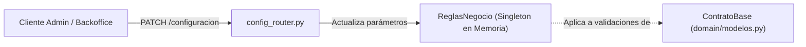
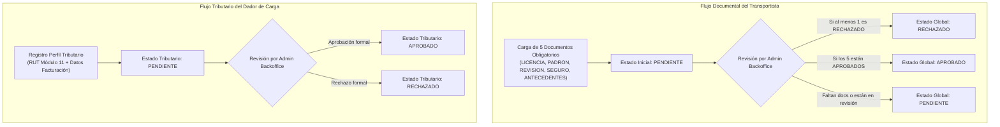

# 📜 Catálogo Oficial de Reglas de Negocio del Sistema
## Plataforma de Digitalización y Centralización de Contratos de Transporte Terrestre de Carga (*MansoViaje*)

### Estructura de Clasificación de Reglas
Las reglas están identificadas unívocamente mediante la nomenclatura `RN-[MÓDULO]-[NÚMERO]`:
* `RN-CFG`: Configuración y Parámetros Globales.
* `RN-IAM`: Identidad, Autenticación y Control de Acceso.
* `RN-KYC`: Onboarding, Verificación Documental y Compliance.
* `RN-CON`: Ciclo de Vida y Máquina de Estados del Contrato.
* `RN-CAR`: Especificaciones de Carga, Ruta y Requerimientos Especiales.
* `RN-ECO`: Consistencia Económica, Tributaria y Financiera.
* `RN-SUB`: Motor de Subastas, Ofertas y Postulaciones.
* `RN-TRK`: Seguimiento Operativo, Entrega y Disputas.
* `RN-DAT`: Persistencia, Integridad y Concurrencia de Datos.

---

## 2. Parámetros Globales y Políticas Parametrizables del Negocio (`RN-CFG`)

Gestionados centralmente a través de la clase Singleton `domain.reglas.ReglasNegocio` y expuestos para modificación en tiempo de ejecución mediante `routers/config_router.py`.



### RN-CFG-01: Tasa Porcentual del Impuesto al Valor Agregado (IVA)
* **Descripción:** Define la alícuota legal del IVA aplicada sobre el valor neto de los contratos de transporte tasados en moneda nacional (CLP).
* **Valor por Defecto:** `0.19` (19% de IVA según normativa del Servicio de Impuestos Internos de Chile).
* **Restricción de Dominio:** El valor debe encontrarse estrictamente en el intervalo cerrado $[0.0, 1.0]$.
* **Comportamiento ante Infracción:** Si se intenta configurar un valor menor a $0$ o mayor a $1$, el sistema lanza `ValueError("El porcentaje del IVA debe estar entre 0 y 1 (ej: 0.19 para 19%)")` retornando código `HTTP 400 Bad Request`.
* **Trazabilidad:** `domain/reglas.py` (Líneas 16, 44-47), `routers/config_router.py`.

### RN-CFG-02: Tolerancia Financiera Universal por Redondeo
* **Descripción:** Margen numérico admisible para absorber discrepancias aritméticas derivadas del redondeo en coma flotante en la suma de montos netos e IVA.
* **Valor por Defecto:** `0.01` unidades monetarias.
* **Restricción de Dominio:** $\text{tolerancia\_max} \ge 0.0$. No se permiten valores negativos.
* **Comportamiento ante Infracción:** Lanza `ValueError("La tolerancia financiera no puede ser negativa")` con código `HTTP 400 Bad Request`.
* **Trazabilidad:** `domain/reglas.py` (Líneas 17, 49-52).

### RN-CFG-03: Tiempo Mínimo de Anticipación de Salida
* **Descripción:** Intervalo temporal mínimo requerido entre el momento en que se emite o programa un contrato y la hora estimada de partida del vehículo.
* **Valor por Defecto:** `2` horas (`ANTICIPACION_MIN_H = 2`).
* **Restricción de Dominio:** $\text{anticipacion\_min\_h} \ge 0$.
* **Comportamiento ante Infracción:** Lanza `ValueError("La anticipacion minima no puede ser negativa")` con código `HTTP 400 Bad Request`.
* **Trazabilidad:** `domain/reglas.py` (Líneas 18, 54-57).

### RN-CFG-04: Modificación en Caliente (Hot Reloading de Políticas)
* **Descripción:** Los administradores pueden modificar los parámetros `iva_porcentaje`, `tolerancia_max` y `anticipacion_min_h` sin necesidad de reiniciar el servicio ni interrumpir las operaciones en curso. Las modificaciones impactan de forma inmediata a los nuevos contratos que se validen a partir de ese instante.
* **Trazabilidad:** `routers/config_router.py` (`PATCH /configuracion`).

---

## 3. Identidad, Autenticación y Control de Accesos (`RN-IAM`)

Implementado en `domain/modelos_usuario.py`, `domain/modelos_login.py`, `services/usuario_service.py`, `services/security.py` y `routers/auth_router.py`.

### RN-IAM-01: Catálogo de Roles y Restricción de Autoregistro
* **Descripción:** La plataforma reconoce formalmente tres roles de usuario:
  1. `TRANSPORTISTA`: Conductor independiente o empresa operadora de camiones.
  2. `DADOR_CARGA`: Empresa o particular generador de requerimientos de flete.
  3. `ADMIN_BACKOFFICE`: Personal administrativo con facultades de auditoría, aprobación y configuración.
* **Regla de Autoregistro:** En el endpoint público de registro (`POST /auth/registro`), **únicamente** se autoriza la creación de cuentas con rol `TRANSPORTISTA` o `DADOR_CARGA`.
* **Comportamiento ante Infracción:** Si se intenta autoregistrar un usuario con `ADMIN_BACKOFFICE` u otra denominación no admitida, Pydantic lanza `ValueError("El rol al registrarse solo puede ser TRANSPORTISTA o DADOR_CARGA")` (`HTTP 400 Bad Request`).
* **Trazabilidad:** `domain/modelos_usuario.py` (Líneas 25-31, 92-102).

### RN-IAM-02: Normalización de Nombres de Rol Heredados
* **Descripción:** Para preservar la interoperabilidad con clientes legados o versiones anteriores de la interfaz:
  * El término `"INDEPENDIENTE"` se normaliza automáticamente al rol canónico `TRANSPORTISTA`.
  * El término `"EMPRESA"` se normaliza automáticamente al rol canónico `DADOR_CARGA`.
* **Trazabilidad:** `domain/modelos_usuario.py` (Líneas 80-90).

### RN-IAM-03: Unicidad e Invariabilidad del Correo Electrónico
* **Descripción:** El correo electrónico actúa como el identificador único del usuario en el sistema IAM:
  * Formato validado estrictamente según la expresión regular `^[\w\.-]+@[\w\.-]+\.\w+$`.
  * Normalización obligatoria a minúsculas (`email.strip().lower()`).
  * No se permite registrar dos cuentas con el mismo correo, independientemente de que se intente registrar en roles distintos o con variaciones de mayúsculas y minúsculas.
* **Comportamiento ante Infracción:** Retorna `HTTP 400 Bad Request: "El email ya está registrado"`.
* **Trazabilidad:** `services/usuario_service.py` (Líneas 25-29), `domain/modelos_usuario.py` (Línea 38).

### RN-IAM-04: Robustez de Contraseña y Almacenamiento Seguro
* **Descripción:** La contraseña provista por el usuario debe poseer una longitud mínima de **6 caracteres**.
* **Almacenamiento:** El sistema **nunca** almacena contraseñas en texto plano. Se calcula su resumen criptográfico unidireccional utilizando SHA-256 (`hash_password(password)`).
* **Comportamiento ante Infracción:** Si la contraseña tiene menos de 6 caracteres, Pydantic genera un error de validación `String should have at least 6 characters` (`HTTP 422 Unprocessable Entity`).
* **Trazabilidad:** `domain/modelos_usuario.py` (Línea 43), `services/usuario_service.py` (Líneas 17-19).

### RN-IAM-05: Estado Inicial de Usuario
* **Descripción:** Todo nuevo usuario registrado mediante `POST /auth/registro` adquiere automáticamente el estado operativo `EN_REVISION` (`EstadoUsuario.EN_REVISION`), requiriendo completar su proceso de Onboarding/KYC antes de operar comercialmente.
* **Trazabilidad:** `domain/modelos_usuario.py` (Líneas 32-35, 107).

### RN-IAM-06: Política de Autenticación y Protección contra Enumeración de Usuarios
* **Descripción:** Durante el inicio de sesión (`POST /auth/login`):
  * Los campos de identificación (`usuario` o `email`) y `password` son obligatorios y no pueden ser cadenas vacías ni contener exclusivamente espacios en blanco.
  * Si el usuario no existe en la base de datos o si la contraseña ingresada no coincide con el hash almacenado, el sistema genera de forma idéntica la excepción `HTTP 401 Unauthorized: "Credenciales inválidas"`.
  * Se evita deliberadamente informar si el fallo radicó en el usuario o en la clave para mitigar ataques de fuerza bruta y enumeración de usuarios.
* **Trazabilidad:** `services/usuario_service.py` (Líneas 74-89), `domain/modelos_login.py` (Líneas 27-41).

### RN-IAM-07: Emisión de Credenciales OAuth2 Bearer y Claims de Sesión
* **Descripción:** Tras una autenticación exitosa, el sistema emite una credencial de acceso en formato JSON Web Token (JWT) firmado con algoritmo simétrico **HMAC-SHA256 (HS256)**.
* **Parámetros del Token:**
  * `sub`: UUID del usuario.
  * `email`: Correo electrónico del usuario.
  * `rol`: Rol asignado (`TRANSPORTISTA`, `DADOR_CARGA` o `ADMIN_BACKOFFICE`).
  * `iss`: Emisor de la credencial (`"camiones_contratos_iam"`).
  * `iat`: Marca temporal UNIX de emisión.
  * `exp`: Tiempo de expiración configurado por defecto en **8 horas** (480 minutos).
* **Trazabilidad:** `services/security.py` (Líneas 19-71), `services/usuario_service.py` (Líneas 117-133).

---

## 4. Onboarding y Verificación Documental (KYC & Fleet Compliance) (`RN-KYC`)

Implementado en `domain/modelos_onboarding.py`, `services/onboarding_service.py` y `routers/onboarding_router.py`.



### RN-KYC-01: Catálogo de Documentación Obligatoria del Transportista
* **Descripción:** Para operar en la plataforma, todo transportista debe presentar formalmente un legajo de **exactamente 5 documentos**:
  1. `LICENCIA_CONDUCIR`: Licencia profesional de conducir al día.
  2. `PADRON_VEHICULO`: Certificado de inscripción en el Registro Nacional de Vehículos Motorizados.
  3. `REVISION_TECNICA`: Certificado de revisión técnica y gases vigente.
  4. `SEGURO_CARGA`: Póliza de seguro de carga o responsabilidad civil vigente.
  5. `ANTECEDENTES`: Certificado oficial de antecedentes del conductor.
* **Trazabilidad:** `domain/modelos_onboarding.py` (Líneas 24-30), `services/onboarding_service.py` (Líneas 23-29).

### RN-KYC-02: Formatos y Extensiones Admitidas de Archivos
* **Descripción:** La referencia o archivo documental cargado por el transportista debe terminar obligatoriamente en alguna de las siguientes extensiones: `.pdf`, `.jpg`, `.jpeg`, `.png`.
* **Comportamiento ante Infracción:** Si el archivo presenta otra extensión (ej. `.docx`, `.exe`, `.zip`), el validador Pydantic rechaza la carga con `ValueError("El formato del archivo debe terminar en .pdf, .jpg, .jpeg o .png")`.
* **Trazabilidad:** `domain/modelos_onboarding.py` (Líneas 41-49, 58-66).

### RN-KYC-03: Versionado y Reemplazo Documental
* **Descripción:** Si un transportista vuelve a subir un documento para un `TipoDocumento` previamente existente, el sistema actualiza la referencia del archivo, renueva la marca temporal `created_at` a la hora actual UTC y **reinicia automáticamente su estado a `PENDIENTE`**, requiriendo una nueva revisión por parte del personal de Backoffice.
* **Trazabilidad:** `services/onboarding_service.py` (Líneas 47-58).

### RN-KYC-04: Determinación Determinista del Estado Global de Habilitación
* **Descripción:** El estado global de cumplimiento del transportista (`EstadoOnboardingTransportistaDTO.estado_global`) se calcula bajo la siguiente tabla de verdad estricta:

| Condición Documental | Estado Global Resultante | Impacto en la Plataforma |
| :--- | :---: | :--- |
| **Al menos un documento cargado está en estado `RECHAZADO`** | `RECHAZADO` | Bloqueo preventivo. No puede postular a fletes. |
| **Faltan documentos por cargar ($< 5$) o alguno se encuentra en `PENDIENTE` (sin rechazos)** | `PENDIENTE` | No habilitado. Debe esperar aprobación o completar legajo. |
| **Los 5 documentos requeridos existen y todos tienen estado `APROBADO`** | `APROBADO` | **Habilitado**. Puede postular libremente a cargas en subasta. |

* **Trazabilidad:** `services/onboarding_service.py` (Líneas 72-106).

### RN-KYC-05: Validación Algorítmica del RUT Chileno (Módulo 11)
* **Descripción:** Todo perfil tributario de Dador de Carga debe declarar un RUT de empresa válido en Chile.
* **Validación Matemática:**
  1. Limpieza de puntos y espacios. Se exige una longitud mínima de 7 caracteres y máxima de 9 caracteres más guion y dígito verificador ($0\text{-}9$ o $K$).
  2. Cálculo del Dígito Verificador (DV) mediante ponderación decreciente de coeficientes $[2, 3, 4, 5, 6, 7]$ sobre el cuerpo invertido del número:
     $$\text{Suma} = \sum_{i=0}^{n-1} d_i \times (2 + i \pmod 6)$$
     $$\text{Resto} = 11 - (\text{Suma} \pmod{11})$$
     $$\text{DV}_{\text{esperado}} = \begin{cases} \text{"0"}, & \text{si Resto} = 11 \\ \text{"K"}, & \text{si Resto} = 10 \\ \text{str(Resto)}, & \text{en otro caso} \end{cases}$$
* **Comportamiento ante Infracción:**
  * Si el formato es erróneo: `ValueError("Formato de RUT inválido: debe contener entre 7 y 9 dígitos incluyendo el verificador")`.
  * Si el DV no coincide: `ValueError("Dígito verificador del RUT inválido: se esperaba 'X'")`.
* **Trazabilidad:** `domain/modelos_onboarding.py` (Líneas 118-139).

### RN-KYC-06: Validación de Datos de Facturación del Dador de Carga
* **Descripción:** El dador de carga debe proveer obligatoriamente:
  * `razon_social`: Mínimo 2 caracteres.
  * `direccion`: Mínimo 3 caracteres.
  * `correo_facturacion`: Formato válido de correo electrónico (`^[\w\.-]+@[\w\.-]+\.\w+$`). Puede ser idéntico o diferente al correo principal de la cuenta de usuario.
* **Trazabilidad:** `domain/modelos_onboarding.py` (Líneas 102-110).

### RN-KYC-07: Reseteo de Validación Tributaria ante Modificaciones
* **Descripción:** Si el dador de carga actualiza su RUT o datos de facturación en `POST /onboarding/dador/perfil`, su estado de validación tributaria se reinicia automáticamente a `PENDIENTE` hasta que Backoffice lo valide nuevamente.
* **Trazabilidad:** `services/onboarding_service.py` (Líneas 123-130).

### RN-KYC-08: Exclusividad Operativa de Backoffice
* **Descripción:** La modificación de estados de validación documental (`validar_documento`) y de perfiles tributarios (`validar_dador`) a `APROBADO` o `RECHAZADO` es potestad exclusiva del personal con rol de administración (`routers/onboarding_router.py`).
* **Trazabilidad:** `services/onboarding_service.py` (Líneas 152-187).

---

## 5. Ciclo de Vida y Máquina de Estados del Contrato (`RN-CON`)

Implementado en `domain/maquina_estados.py`, `services/contrato_service.py` y `routers/contratos_router.py`.

### RN-CON-01: Compliance Gating para Creación de Contratos
* **Descripción:** Ningún dador de carga puede registrar un contrato de transporte si no cuenta previamente con su perfil tributario y verificación KYC en estado `APROBADO`.
* **Comportamiento ante Infracción:** Se deniega la operación arrojando `PermissionError("La empresa generadora X no cuenta con su verificacion KYC/Onboarding en estado APROBADO.")`, la cual se traduce en `HTTP 403 Forbidden`.
* **Trazabilidad:** `services/contrato_service.py` (Líneas 27-31), `routers/contratos_router.py` (Líneas 44-48).

### RN-CON-02: Estado Inicial del Contrato
* **Descripción:** Todo nuevo contrato creado a través de `POST /contratos` ingresa al sistema con estado inicial `BORRADOR` (`EstadoContrato.BORRADOR`), sin transportista ni camión asignado.
* **Trazabilidad:** `domain/modelos.py` (Línea 192), `services/contrato_service.py` (Líneas 25-34).

### RN-CON-03: Matriz de Transiciones Permitidas
La clase `domain.maquina_estados.MaquinaEstadosContrato` encapsula la matriz de transiciones legales del sistema:

| Estado Origen | Estados Destino Permitidos | Transiciones Bloqueadas (Ejemplos) |
| :--- | :--- | :--- |
| `BORRADOR` | `PUBLICADO`, `EN_SUBASTA`, `CANCELADO` | No puede pasar a `EN_TRANSITO`, `ADJUDICADO` ni `FINALIZADO`. |
| `PUBLICADO` | `EN_SUBASTA`, `EN_POSTULACION`, `ADJUDICADO`, `CANCELADO` | No puede pasar a `EN_TRANSITO` ni `FINALIZADO`. |
| `EN_SUBASTA` | `EN_POSTULACION`, `ADJUDICADO`, `CANCELADO` | No puede volver a `BORRADOR`. |
| `EN_POSTULACION` | `ADJUDICADO`, `CANCELADO` | No puede volver a `PUBLICADO`. |
| `ADJUDICADO` | `EN_TRANSITO`, `CANCELADO` | No puede pasar a `ENTREGADO` sin pasar por `EN_TRANSITO`. |
| `EN_TRANSITO` | `ENTREGADO`, `EN_DISPUTA` | No puede pasar a `FINALIZADO` ni cancelarse directamente. |
| `ENTREGADO` | `FINALIZADO`, `EN_DISPUTA` | No puede devolverse a `EN_TRANSITO`. |
| `EN_DISPUTA` | `FINALIZADO`, `CANCELADO` | Solo puede resolverse hacia cierre definitivo. |
| `FINALIZADO` | *Ninguno* (Conjunto vacío) | **Estado terminal inmutable**. |
| `CANCELADO` | *Ninguno* (Conjunto vacío) | **Estado terminal inmutable**. |

* **Comportamiento ante Infracción:** Intentar una transición no listada arroja `ValueError("Transicion de estado no permitida, no se puede pasar de X a Y")` con código `HTTP 400 Bad Request`.
* **Trazabilidad:** `domain/maquina_estados.py` (Líneas 61-100).

### RN-CON-04: Invariantes de Publicación
* **Descripción:** Al avanzar un contrato a `PUBLICADO` o `EN_SUBASTA`:
  1. No puede existir un transportista previamente asignado (`id_transportista is None`).
  2. Si el contrato no poseía fecha de publicación, se le estampa automáticamente la marca temporal actual en UTC (`fecha_publicacion = datetime.now(UTC)`).
* **Trazabilidad:** `domain/maquina_estados.py` (Líneas 117-122).

### RN-CON-05: Invariantes de Adjudicación
* **Descripción:** Para efectuar la transición hacia el estado `ADJUDICADO`, es **estrictamente obligatorio** proporcionar el identificador del transportista asignado (`id_transportista`). Opcionalmente se puede asociar el vehículo (`id_camion`).
* **Comportamiento ante Infracción:** Si se invoca sin `id_transportista`, lanza `ValueError("Para adjudicar un contrato se requiere indicar obligatoriamente 'id_transportista'")`.
* **Trazabilidad:** `domain/maquina_estados.py` (Líneas 123-128).

---

## 6. Especificaciones de Carga, Ruta y Requerimientos Especiales (`RN-CAR`)

Implementado en `domain/modelos.py` (`ContratoBase`).

### RN-CAR-01: Sanitización y Normalización de Textos de Ruta
* **Descripción:** Los campos `origen` y `destino` son procesados mediante el sanitizador `TextoNormalizado`:
  * Se eliminan espacios en blanco superfluos al inicio, al final y espacios múltiples intermedios.
  * Se convierten todos los caracteres a **MAYÚSCULAS**.
  * Se exige una longitud mínima de 3 caracteres utilizables.
* **Trazabilidad:** `domain/modelos.py` (Líneas 33-40, 75-76).

### RN-CAR-02: Restricción de Ruta (Origen Distinto de Destino)
* **Descripción:** La dirección o comuna de origen no puede ser idéntica a la de destino.
* **Comportamiento ante Infracción:** Si `origen == destino`, lanza `ValueError("El origen y destino no pueden ser identicos")` (`HTTP 400 Bad Request`).
* **Trazabilidad:** `domain/modelos.py` (Líneas 119-120).

### RN-CAR-03: Coherencia de Fechas y Cronología Operativa
* **Descripción:** El contrato exige tres marcas temporales conscientes de zona horaria (`AwareDatetime`), las cuales deben satisfacer la siguiente cronología:
  1. **Anticipación de Salida:**
     $$f_{\text{estimada\_salida}} > t_{\text{actual}} + \text{ANTICIPACION\_MIN\_H}$$
     La salida debe programarse con al menos 2 horas de holgura respecto a la hora UTC actual.
  2. **Cronología de Llegada:**
     $$f_{\text{estimada\_llegada}} > f_{\text{estimada\_salida}}$$
     La llegada estimada debe ser estrictamente posterior a la partida.
  3. **Cierre de Postulaciones:**
     $$f_{\text{cierre\_postulaciones}} \le f_{\text{estimada\_salida}}$$
     La convocatoria y recepción de ofertas debe finalizar antes o en el mismo momento fijado para la salida del camión.
* **Comportamiento ante Infracción:** Lanza `ValueError` con la descripción específica del conflicto temporal (`HTTP 400 Bad Request`).
* **Trazabilidad:** `domain/modelos.py` (Líneas 102-116).

### RN-CAR-04: Capacidad Máxima Vehicular y Sobrepeso
* **Descripción:** El peso total de la carga declarada (`peso_total > 0`) no puede sobrepasar la capacidad de carga nominal del camión requerido (`input_camionKG > 0`):
  $$P_{\text{total}} \le C_{\text{camión}}$$
* **Comportamiento ante Infracción:** Si existe sobrepeso, el validador calcula la diferencia exacta y lanza:
  `ValueError(f"El peso de la carga supera la capacidad del camion por {exceso} KG")`.
* **Trazabilidad:** `domain/modelos.py` (Líneas 121-124).

### RN-CAR-05: Requerimientos Especiales según Tipología de Carga
El sistema reconoce 11 tipos de carga (`TipoCarga`), exigiendo condiciones de seguridad obligatorias para 4 de ellas:

1. **Carga Refrigerada y Perecedera (`TipoCarga.REFRIGERADA`, `TipoCarga.PERECEDERA`):**
   * Exige forzosamente activar la casilla de refrigeración: `requiere_termo == True`.
   * Error: `ValueError("La carga X requiere activar la opcion de termo/refrigeracion")`.
2. **Carga Peligrosa (`TipoCarga.PELIGROSA`):**
   * Exige obligatoriamente el código de sustancia peligrosa asignado por la ONU (`numero_onu`).
   * El código debe cumplir la expresión regular `^(UN)?\d{4}$` (ej. `1203`, `UN1203`, insensible a mayúsculas).
   * Error: `ValueError("Las cargas peligrosas requieren un codigo ONU obligatorio")` o `ValueError("Codigo ONU 'X' invalido. Debe constar de 4 digitos (ej: 1234 o UN1234)")`.
3. **Carga de Valores (`TipoCarga.VALORES`):**
   * Exige transporte blindado de alta seguridad: `req_blindaje == True`.
   * Error: `ValueError("Las cargas de valores requieren obligatoriamente un camion blindado")`.
4. **Carga Frágil (`TipoCarga.FRAGIL`):**
   * Exige instrucciones específicas de embalaje (`req_embalaje`) con una extensión mínima de **10 caracteres** utilizables.
   * Error: `ValueError("La carga fragil requiere una especificacion de embalaje de al menos 10 caracteres")`.
* **Trazabilidad:** `domain/modelos.py` (Líneas 126-146).

---

## 7. Consistencia Económica, Tributaria y Financiera (`RN-ECO`)

Implementado en `domain/modelos.py` (`_validar_coherencia_financiera`).

### RN-ECO-01: Catálogo de Monedas Homologadas
* **Descripción:** Se admiten únicamente las monedas definidas en la enumeración `Moneda`:
  * Nacionales / Reajustables: `CLP` (Peso Chileno - valor por defecto), `UF` (Unidad de Fomento), `UTM` (Unidad Tributaria Mensual).
  * Extranjeras: `USD` (Dólar estadounidense), `EUR` (Euro), `CNY` (Yuan chino), `BRL` (Real brasileño).
* **Trazabilidad:** `domain/modelos.py` (Líneas 59-69, 95).

### RN-ECO-02: Positividad de los Montos Financieros
* **Descripción:**
  * `monto_neto`: Debe ser un valor estrictamente positivo ($> 0.0$).
  * `monto_iva`: Debe ser un valor mayor o igual a cero ($\ge 0.0$).
  * `monto_total`: Debe ser un valor estrictamente positivo ($> 0.0$).
* **Trazabilidad:** `domain/modelos.py` (Líneas 96-98).

### RN-ECO-03: Ecuación de Consistencia Contable Universal
* **Descripción:** En cualquier moneda admitida, la suma aritmética del monto neto más el monto del IVA debe cuadrar exactamente con el monto total declarado, admitiendo una tolerancia máxima por redondeo definida por `ReglasNegocio.TOLERANCIA_MAX` ($0.01$):
  $$|(\text{monto\_neto} + \text{monto\_iva}) - \text{monto\_total}| \le 0.01$$
* **Comportamiento ante Infracción:** Lanza `ValueError(f"El monto total ({monto_total}) no coincide con la suma del neto ({monto_neto}) e IVA ({monto_iva})")`.
* **Trazabilidad:** `domain/modelos.py` (Líneas 148-154).

### RN-ECO-04: Verificación Tributaria del IVA en Pesos Chilenos (CLP)
* **Descripción:** Si la moneda pactada es `Moneda.CLP`, el monto de IVA consignado debe coincidir matemáticamente con el 19% del monto neto ($0.19 \times \text{monto\_neto}$), otorgando una holgura por redondeo de enteros de máximo **$5 CLP** (`TOLERANCIA_IVA_CLP = 5.0`):
  $$|\text{monto\_iva} - (\text{monto\_neto} \times \text{ReglasNegocio.IVA\_PORCENTAJE})| \le 5.0$$
* **Comportamiento ante Infracción:** Si el IVA no corresponde al 19%, se rechaza el contrato con `ValueError(f"El monto del IVA ({monto_iva}) no corresponde al 19.0% del neto")`.
* **Trazabilidad:** `domain/modelos.py` (Líneas 29, 156-163).

---

## 8. Motor de Subastas, Ofertas y Postulaciones (`RN-SUB`)

Implementado en `domain/postulacion.py`, `services/subasta_service.py` y `routers/subasta_router.py`.

### RN-SUB-01: Disponibilidad de Cargas para Postulación
* **Descripción:** Un transportista solo puede visualizar y postular a cargas que se encuentren en estados elegibles:
  * `EstadoContrato.PUBLICADO`
  * `EstadoContrato.EN_SUBASTA`
  * `EstadoContrato.EN_POSTULACION`
* **Bloqueo:** Quedan absolutamente excluidas de postulación aquellas cargas en `ADJUDICADO`, `EN_TRANSITO`, `ENTREGADO`, `FINALIZADO` o `CANCELADO`.
* **Trazabilidad:** `services/subasta_service.py` (Líneas 11-21, 71-73, 121-124).

### RN-SUB-02: Compliance Gating de Postulación del Transportista
* **Descripción:** Para registrar una postulación a un flete, el transportista oferente debe poseer su estado global de Onboarding/KYC debidamente `APROBADO`.
* **Comportamiento ante Infracción:** Si el transportista no cuenta con aprobación documental completa, se rechaza la oferta con `ValueError("El transportista debe tener su onboarding en estado 'APROBADO' para postular")` (`HTTP 400 Bad Request`).
* **Trazabilidad:** `services/subasta_service.py` (Líneas 114-116).

### RN-SUB-03: Tarifa Mínima de Postulación (Piso de Oferta)
* **Descripción:** Para evitar prácticas de competencia desleal o tarifas predatorias, se instituye una tarifa mínima legal por oferta:
  $$\text{precio\_oferta} \ge \$5.000\text{ CLP} \quad (\text{TARIFA\_MINIMA\_POSTULACION\_CLP} = 5000.0)$$
* **Comportamiento ante Infracción:** Si la oferta es menor a \$5.000 CLP, Pydantic genera un error de validación `Input should be greater than or equal to 5000` (`HTTP 422 Unprocessable Entity`).
* **Trazabilidad:** `domain/postulacion.py` (Líneas 13, 50-54).

### RN-SUB-04: Estimación del Tiempo de Entrega
* **Descripción:** La postulación debe incluir obligatoriamente el tiempo estimado de entrega en horas (`tiempo_entrega_horas`), el cual debe ser estrictamente positivo ($> 0.0$).
* **Trazabilidad:** `domain/postulacion.py` (Línea 55).

### RN-SUB-05: Transición Automática del Contrato ante la Primera Oferta
* **Descripción:** Cuando una carga se encuentra en estado `PUBLICADO` o `EN_SUBASTA` y recibe su primera postulación válida, el sistema transiciona automáticamente el estado del contrato a `EN_POSTULACION`, reflejando en tiempo real que el flete ya cuenta con transportistas interesados compitiendo.
* **Trazabilidad:** `services/subasta_service.py` (Líneas 129-135).

### RN-SUB-06: Adjudicación Atómica y Rechazo Masivo de Ofertas Competidoras
* **Descripción:** Cuando el dador de carga decide adjudicar la subasta a una postulación ganadora (`POST /subastas/adjudicar`):
  1. Se valida que la carga y la postulación pertenezcan a la misma relación comercial y que la carga no haya sido cerrada previamente.
  2. La postulación seleccionada muta su estado a `EstadoPostulacion.SELECCIONADA`.
  3. **Rechazo Atómico Masivo:** Todas las demás postulaciones recibidas para esa misma carga que no resultaron favorecidas transicionan inmediatamente a `EstadoPostulacion.RECHAZADA`.
  4. El contrato de carga transiciona formalmente a `EstadoContrato.ADJUDICADO`, inscribiendo el `id_transportista` de la oferta ganadora.
* **Trazabilidad:** `services/subasta_service.py` (Líneas 139-186), `dao/postulacion_dao.py` (Líneas 57-65).

---

## 9. Seguimiento Operativo, Entrega y Disputas (`RN-TRK`)

Implementado en `domain/maquina_estados.py` y `Arquitectura.md`.

### RN-TRK-01: Inicio Formal del Tránsito Operativo
* **Descripción:** Únicamente los contratos que se encuentren en estado `ADJUDICADO` (con transportista formalmente asignado) pueden avanzar al estado `EN_TRANSITO`.
* **Significado Operativo:** El conductor ha acudido al punto de origen, ha cargado la mercancía y comienza el traslado carretero.
* **Trazabilidad:** `domain/maquina_estados.py` (Líneas 82-85).

### RN-TRK-02: Confirmación de Llegada y Descarga
* **Descripción:** Únicamente desde el estado `EN_TRANSITO` se puede registrar la transición a `ENTREGADO`.
* **Significado Operativo:** El camión arriba al destino pactado y se procede a la descarga física del flete.
* **Trazabilidad:** `domain/maquina_estados.py` (Líneas 86-89).

### RN-TRK-03: Levantamiento de Disputas Operativas
* **Descripción:** En caso de suscitarse anomalías graves (mermas, roturas de cadena de frío en carga refrigerada, daños por embalaje en carga frágil, extravío o demoras desmedidas), las partes pueden elevar el contrato a estado `EN_DISPUTA`.
* **Condición Temporal:** La disputa **únicamente** puede abrirse mientras el contrato se halle en `EN_TRANSITO` o en `ENTREGADO`. No se permite levantar disputas en contratos no adjudicados ni en aquellos que ya fueron formalmente finalizados.
* **Trazabilidad:** `domain/maquina_estados.py` (Líneas 88, 92, 96-99).

### RN-TRK-04: Resolución de Disputas y Arbitraje
* **Descripción:** Un contrato en estado `EN_DISPUTA` solo admite dos desenlaces posibles mediante la intervención de Admin Backoffice:
  1. `FINALIZADO`: Tras una mediación exitosa, acuerdo compensatorio o pago de deducible.
  2. `CANCELADO`: Por incumplimiento total o anulación formal con restitución de fondos.
* **Trazabilidad:** `domain/maquina_estados.py` (Líneas 96-99).

### RN-TRK-05: Cierre Definitivo y Liquidación Escrow
* **Descripción:** Un contrato en estado `ENTREGADO` avanza a `FINALIZADO` una vez que el dador de carga otorga su conformidad o vence el plazo de reclamo sin observaciones, liberando los fondos retenidos en custodia (*Escrow*) hacia el transportista.
* **Trazabilidad:** `domain/maquina_estados.py` (Líneas 90-93).

---

## 10. Persistencia, Concurrencia e Integridad de Datos (`RN-DAT`)

Implementado en `dao/base_dao.py`, `dao/sqlite_db.py`, `dao/usuario_dao.py` y `dao/onboarding_dao.py`.

### RN-DAT-01: Concurrencia Segura en Memoria (Thread-Safe RLock)
* **Descripción:** Las implementaciones en memoria (`DAOMemoria`, `ContratoDAOInMemory`, `PostulacionDAOInMemory`) protegen todas las operaciones de lectura y mutación mediante un bloqueo reentrante seguro de concurrencia:
  ```python
  self._bloqueo = threading.RLock()
  with self._bloqueo:
      # Operación atómica aislada contra carreras críticas
  ```
* **Trazabilidad:** `dao/base_dao.py` (Líneas 65-170).

### RN-DAT-02: Integridad Referencial en Almacenamiento Relacional (SQLite)
* **Descripción:** En las implementaciones persistentes sobre SQLite, cada conexión entrante ejecuta de manera obligatoria la instrucción:
  ```sql
  PRAGMA foreign_keys = ON;
  ```
  Esto garantiza que los identificadores de usuario asociados a documentos KYC y perfiles tributarios respeten las restricciones de llave foránea contra la tabla principal de usuarios.
* **Trazabilidad:** `dao/sqlite_db.py` (Líneas 16-25), `dao/schema_usuarios.sql`.

### RN-DAT-03: Búsquedas Insensibles a Mayúsculas en Base de Datos
* **Descripción:** Para impedir duplicidades de cuenta por discrepancias tipográficas en el email, las consultas de autenticación y verificación de existencia ejecutan comparaciones normalizadas a minúsculas (`LOWER(email) = LOWER(?)`), complementadas con un índice único en el esquema SQL.
* **Trazabilidad:** `dao/usuario_dao.py` (Líneas 130-150), `dao/sqlite_db.py` (Líneas 70-76).

---

## 11. Matriz de Trazabilidad Cruzada: Regla vs. Código vs. Endpoint

| Código Regla | Nombre Resumido | Archivo de Dominio / Servicio | Endpoint / Router Asociado | Estado / Excepción |
| :--- | :--- | :--- | :--- | :--- |
| **RN-CFG-01** | Rango legal de IVA ($0 \text{ a } 1$) | `domain/reglas.py` | `PATCH /configuracion` | `HTTP 400 ValueError` |
| **RN-CFG-02** | Tolerancia financiera no negativa | `domain/reglas.py` | `PATCH /configuracion` | `HTTP 400 ValueError` |
| **RN-CFG-03** | Anticipación mínima $\ge 0$ horas | `domain/reglas.py` | `PATCH /configuracion` | `HTTP 400 ValueError` |
| **RN-IAM-01** | Autoregistro solo Transportista/Dador | `domain/modelos_usuario.py` | `POST /auth/registro` | `HTTP 400 ValueError` |
| **RN-IAM-02** | Normalización Independiente/Empresa | `domain/modelos_usuario.py` | `POST /auth/registro` | Conversión silenciosa |
| **RN-IAM-03** | Unicidad y formato de Email | `services/usuario_service.py` | `POST /auth/registro` | `HTTP 400 Bad Request` |
| **RN-IAM-04** | Password $\ge 6$ chars y SHA-256 | `domain/modelos_usuario.py` | `POST /auth/registro` | `HTTP 422 ValidationError` |
| **RN-IAM-05** | Estado inicial `EN_REVISION` | `domain/modelos_usuario.py` | `POST /auth/registro` | Asignación default |
| **RN-IAM-06** | Prevención de enumeración de usuarios | `services/usuario_service.py` | `POST /auth/login` | `HTTP 401 Unauthorized` |
| **RN-IAM-07** | Emisión token JWT Bearer (8h) | `services/security.py` | `POST /auth/login` | `HTTP 200 OK` |
| **RN-KYC-01** | Legajo de 5 documentos obligatorios | `domain/modelos_onboarding.py` | `POST /onboarding/transportista/documentos` | `HTTP 201 Created` |
| **RN-KYC-02** | Extensiones `.pdf`, `.jpg`, `.jpeg`, `.png` | `domain/modelos_onboarding.py` | `POST /onboarding/transportista/documentos` | `HTTP 422 ValueError` |
| **RN-KYC-03** | Recarga reinicia a `PENDIENTE` | `services/onboarding_service.py` | `POST /onboarding/transportista/documentos` | Reinicio de estado |
| **RN-KYC-04** | Regla tripartita de estado global KYC | `services/onboarding_service.py` | `GET /onboarding/transportista/estado` | `HTTP 200 OK` |
| **RN-KYC-05** | RUT Chileno Módulo 11 | `domain/modelos_onboarding.py` | `POST /onboarding/dador/perfil` | `HTTP 422 ValueError` |
| **RN-KYC-06** | Datos de facturación obligatorios | `domain/modelos_onboarding.py` | `POST /onboarding/dador/perfil` | `HTTP 422 ValidationError` |
| **RN-KYC-07** | Modificación tributaria reinicia a `PENDIENTE`| `services/onboarding_service.py` | `POST /onboarding/dador/perfil` | Reinicio de estado |
| **RN-CON-01** | Compliance Gating de Dador de Carga | `services/contrato_service.py` | `POST /contratos` | `HTTP 403 PermissionError` |
| **RN-CON-02** | Estado inicial `BORRADOR` | `domain/modelos.py` | `POST /contratos` | `HTTP 201 Created` |
| **RN-CON-03** | Matriz de transiciones de contrato | `domain/maquina_estados.py` | `PATCH /contratos/{id}/estado` | `HTTP 400 ValueError` |
| **RN-CON-04** | Invariante publicación y fecha UTC | `domain/maquina_estados.py` | `PATCH /contratos/{id}/estado` | `HTTP 400 ValueError` |
| **RN-CON-05** | Invariante adjudicación (id_transportista) | `domain/maquina_estados.py` | `PATCH /contratos/{id}/estado` | `HTTP 400 ValueError` |
| **RN-CAR-01** | Limpieza y mayúsculas de origen/destino | `domain/modelos.py` | `POST /contratos` | Normalización `BeforeValidator` |
| **RN-CAR-02** | Origen distinto de Destino | `domain/modelos.py` | `POST /contratos` | `HTTP 400 ValueError` |
| **RN-CAR-03** | Fechas: Anticipación, llegada y cierre | `domain/modelos.py` | `POST /contratos` | `HTTP 400 ValueError` |
| **RN-CAR-04** | Carga $\le$ Capacidad camión | `domain/modelos.py` | `POST /contratos` | `HTTP 400 ValueError` |
| **RN-CAR-05** | Reglas especiales (Termo, ONU, Blindaje) | `domain/modelos.py` | `POST /contratos` | `HTTP 400 ValueError` |
| **RN-ECO-01** | Catálogo de monedas autorizadas | `domain/modelos.py` | `POST /contratos` | `HTTP 422 ValidationError` |
| **RN-ECO-02** | Positividad de montos económicos | `domain/modelos.py` | `POST /contratos` | `HTTP 422 ValidationError` |
| **RN-ECO-03** | Consistencia contable (Neto + IVA = Total) | `domain/modelos.py` | `POST /contratos` | `HTTP 400 ValueError` |
| **RN-ECO-04** | IVA 19% en CLP con tolerancia de \$5 | `domain/modelos.py` | `POST /contratos` | `HTTP 400 ValueError` |
| **RN-SUB-01** | Cargas disponibles (PUBLICADO/SUBASTA/POST) | `services/subasta_service.py` | `GET /subastas/cargas` | Filtro en memoria/DAO |
| **RN-SUB-02** | Compliance Gating transportista en oferta | `services/subasta_service.py` | `POST /subastas/postular` | `HTTP 400 ValueError` |
| **RN-SUB-03** | Oferta mínima \$5.000 CLP | `domain/postulacion.py` | `POST /subastas/postular` | `HTTP 422 ValidationError` |
| **RN-SUB-04** | Tiempo estimado de entrega $> 0$ | `domain/postulacion.py` | `POST /subastas/postular` | `HTTP 422 ValidationError` |
| **RN-SUB-05** | Avance automático a `EN_POSTULACION` | `services/subasta_service.py` | `POST /subastas/postular` | Transición de estado |
| **RN-SUB-06** | Adjudicación y descarte de competidores | `services/subasta_service.py` | `POST /subastas/adjudicar` | Mutación atómica en DAO |
| **RN-TRK-01** | Transición a `EN_TRANSITO` desde `ADJUDICADO` | `domain/maquina_estados.py` | `PATCH /contratos/{id}/estado` | `HTTP 400 ValueError` |
| **RN-TRK-02** | Transición a `ENTREGADO` desde `EN_TRANSITO` | `domain/maquina_estados.py` | `PATCH /contratos/{id}/estado` | `HTTP 400 ValueError` |
| **RN-TRK-03** | Apertura de `EN_DISPUTA` en viaje/entrega | `domain/maquina_estados.py` | `PATCH /contratos/{id}/estado` | `HTTP 400 ValueError` |
| **RN-TRK-04** | Resolución hacia `FINALIZADO` o `CANCELADO`| `domain/maquina_estados.py` | `PATCH /contratos/{id}/estado` | `HTTP 400 ValueError` |
| **RN-TRK-05** | Liquidación Escrow hacia `FINALIZADO` | `domain/maquina_estados.py` | `PATCH /contratos/{id}/estado` | `HTTP 400 ValueError` |
| **RN-DAT-01** | Concurrencia segura `threading.RLock` | `dao/base_dao.py` | Capa DAO Memoria | Aislamiento de hebras |
| **RN-DAT-02** | Integridad relacional `PRAGMA foreign_keys`| `dao/sqlite_db.py` | Capa DAO SQLite | Integridad referencial |
| **RN-DAT-03** | Consultas `LOWER(email)` para unicidad | `dao/usuario_dao.py` | Capa DAO SQLite | Búsqueda insensible a caja |

---