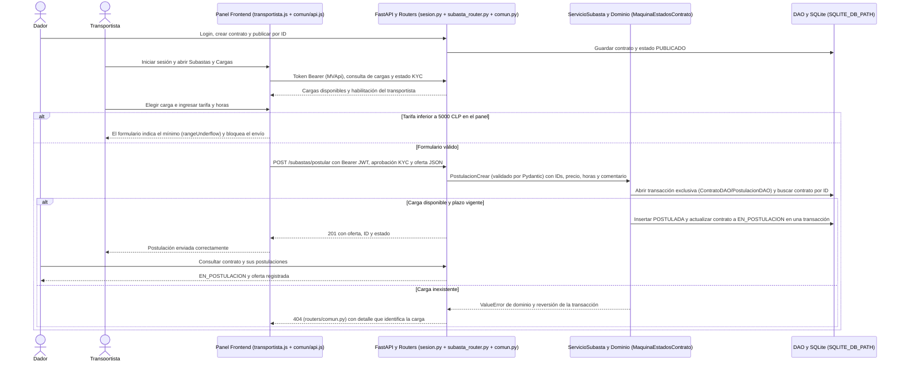

# Integración y verificación de la postulación a una carga

Un dador publica una carga y un transportista habilitado envía una oferta desde el panel. La operación termina cuando el dador puede consultar la oferta y el contrato pasa de `PUBLICADO` a `EN_POSTULACION`. La [prueba del panel](../frontend/tests/panel.e2e.cjs) usa las mismas páginas que carga Electron y contrasta el mensaje en pantalla con dos lecturas posteriores de la API.

## Recorrido de los datos



El [panel](../frontend/codigos/paginas/panel/transportista.js) consulta el estado de onboarding y envía las solicitudes autenticadas mediante el cliente compartido [`comun/api.js`](../frontend/codigos/paginas/comun/api.js) (`window.MVApi`), incluyendo el indicador de aprobación en la consulta. FastAPI comprueba el token Bearer en [`routers/sesion.py`](../routers/sesion.py) (delegando en [`services/sesion_service.py`](../services/sesion_service.py)) y Pydantic valida el cuerpo antes de llamar al [router](../routers/subasta_router.py). El [servicio](../services/subasta_service.py) comprueba la disponibilidad y el plazo operando sobre [`dao/contrato_dao.py`](../dao/contrato_dao.py) y [`dao/postulacion_dao.py`](../dao/postulacion_dao.py). La [conexión SQLite](../database/conexion.py) (`SQLITE_DB_PATH`) confirma o revierte ambas escrituras juntas. El [adaptador de errores](../routers/comun.py) convierte una carga inexistente en HTTP 404 y el resto de errores de negocio en HTTP 400. El panel muestra el detalle recibido si falla el envío y redirige a Login si recibe HTTP 401.

## Registro de ejecución

Entorno local compartido por los tres casos el 24 de noviembre de 2026: Windows, Python 3.15.2, FastAPI 0.162.4, Pydantic 2.14.3, Uvicorn 0.54.0, SQLite 3.53.4, Node 26.13.0, Playwright 1.65.1 y Edge 158.0.4370.33. La prueba inicia la API en un puerto local libre, configura `SQLITE_DB_PATH` en un directorio temporal con permiso de escritura e inicializa el esquema y los usuarios ficticios. Usa el navegador y el servidor reales. La ventana nativa de Electron queda fuera de esta comprobación.

| Caso y pasos | Resultado esperado | Resultado obtenido |
| --- | --- | --- |
| **Datos inválidos.** Publicar la carga Valparaíso–Concepción, abrirla como transportista e intentar enviar 4.900 CLP. Consultar contrato y ofertas como dador. | El formulario exige al menos 5.000 CLP. El contrato conserva todos sus campos y sigue sin ofertas. | El navegador activó `rangeUnderflow`. La consulta devolvió el contrato idéntico al inicial, en `PUBLICADO`, y una lista vacía. |
| **Datos válidos.** En el mismo formulario, corregir a 180.000 CLP y enviar. Leer el contrato y la lista de ofertas desde la sesión del dador. | HTTP 201, confirmación visible, una oferta por el importe indicado y transición a `EN_POSTULACION`. | El panel confirmó el envío. La API devolvió `POSTULADA` para el ID de la carga. La lectura posterior devolvió exactamente esa oferta y el contrato en `EN_POSTULACION`. |
| **Recurso ausente.** Repetir por HTTP la solicitud del transportista con la misma sesión y datos, sustituyendo solo el ID de carga por un UUID inexistente. Consultar de nuevo la carga de control y sus ofertas. | HTTP 404 con indicación de carga inexistente. La oferta anterior y su contrato se conservan. | La API respondió 404 con el detalle «no existe». El contrato coincidió campo por campo con el anterior y la lista conservó su única oferta. |

El último caso reproduce una referencia caducada en la conexión panel–API. Se envía directamente porque el selector del panel solo ofrece cargas existentes. Ningún servicio externo fue simulado.

## Cómo repetir la demostración

Desde la raíz, con Python, Node y Microsoft Edge instalados, ejecutar en PowerShell:

```powershell
python -m pip install -r requirements.txt pytest
npm --prefix frontend ci
npm --prefix frontend run test:panel
python -m coverage run -m pytest -q
python -m coverage report -m
python -m coverage xml
```

El panel imprime un resultado por caso y termina con código 0 si se cumplen todas las aserciones.

### Alcance de cobertura, suite actual y ejecución de CI

* **Carpetas medidas por Coverage.py ([`.coveragerc`](../.coveragerc)):** `database/`, `domain/`, `routers/` y `services/` con medición de ramas (`branch = True`). Se omiten `tests/`, `.venv/` y `frontend/` (el frontend se verifica de extremo a extremo con `npm run test:panel`); la carpeta `dao/` queda fuera de `source` en `.coveragerc` y se verifica mediante la suite de persistencia e integración (`tests/persistencia/`, `tests/test_panel_admin.py` y `tests/seguridad/test_sesion_service.py`).
* **Suite verificada sobre `Dev`:** `pytest -q` registra **229 pruebas y 76 subpruebas aprobadas**, con `ruff check .` y `npx tsc --noEmit` sin errores.
* **Integración continua (GitHub Actions):** El flujo [`.github/workflows/tests.yml`](../.github/workflows/tests.yml) ejecuta ambos jobs (`backend` con `ruff`, `pytest` y `coverage`, más `frontend` con `tsc --noEmit` y `npm run test:panel`) automáticamente en cada `push` a `main`, `Dev` y `RamaSS` y en cada `pull_request`.
* **Reporte de cobertura registrado:** [cobertura-criterio-6.txt](cobertura-criterio-6.txt) conserva el detalle por módulo de la corrida verde de CI ([ejecución #45510972035](https://github.com/hamburgetestudent/Camiones_contratos/actions/runs/45510972035) sobre `c091544`: 216 pruebas y **93,9 %** de cobertura). Las corridas posteriores en `Dev` y `main` publican el artefacto actualizado `cobertura` (`coverage.xml`) y el reporte en consola del job `backend`.
