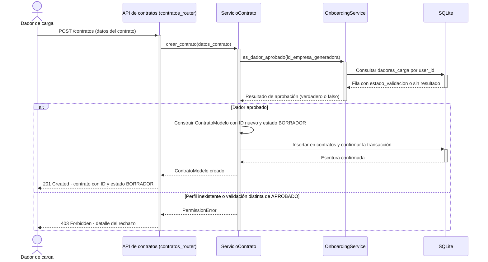

# Diagrama de secuencia · Crear contrato en borrador

El dador de carga solicita la creación mediante la API. El recorrido comienza con una solicitud que cumple el esquema `ContratoCrear`.

## Nota de lectura

Elegimos este caso porque crear un contrato depende de una decisión que se toma en otro módulo. 
`ServicioContrato` delega la consulta en `OnboardingService`, que conoce el estado de validación del dador de carga. 
Al seguir la llamada se observa que el identificador de la empresa se usa para buscar el perfil por `user_id`. 
Tanto la ausencia de perfil como una validación pendiente producen el mismo rechazo antes de escribir en `contratos`. 
En la ruta aprobada, `ContratoModelo` asigna el identificador y el estado inicial. El cliente recibe ambos después de confirmarse la escritura.

## Referencias en el repositorio

- [Entrada HTTP y respuestas 201 y 403](../../routers/contratos_router.py)
- [Creación y persistencia del contrato](../../services/contrato_service.py)
- [Consulta del perfil y criterio de aprobación](../../services/onboarding_service.py)
- [Valores iniciales de ContratoModelo](../../domain/modelos.py) y [confirmación de la transacción](../../database/conexion.py)
