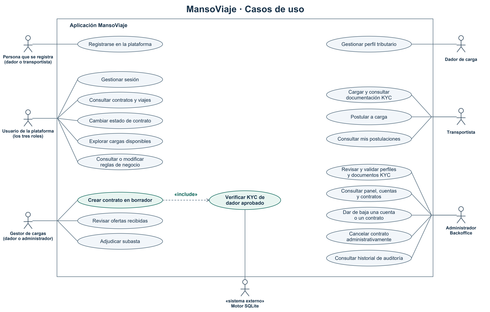

# MansoViaje · Casos de uso

[Fuente editable en draw.io](1-casos-de-uso.drawio) · [Respaldo PDF](1-casos-de-uso.pdf) · [Imagen a tamaño completo](1-casos-de-uso.png)

## Nota de lectura

La frontera encierra las acciones que ofrece MansoViaje, desde el registro hasta la administración de contratos.  
Los pagos en custodia y la recuperación de contraseña quedan fuera del alcance de las rutas implementadas.  
Agrupamos a quienes comparten permisos para que se vea por qué tanto el dador como el administrador pueden gestionar una carga.  
Distinguimos postular de adjudicar porque el transportista presenta una oferta y otro actor decide cuál gana.  
Crear un contrato incluye verificar el perfil del dador indicado en la solicitud. Si falta la aprobación, el proceso termina antes de guardar.  
El motor SQLite queda fuera de la aplicación como dependencia técnica. Su asociación con la verificación identifica dónde se consulta la aprobación.

## Actores y permisos

Los tres roles de cuenta son **Dador de carga**, **Transportista** y **Administrador Backoffice**. A la izquierda se agrupan sus capacidades comunes. *Persona que se registra* representa a quien solicita una cuenta de dador o transportista. *Usuario de la plataforma* representa a cualquiera de los tres roles y *Gestor de cargas* reúne a dadores y administradores, tal como establece `gestion_cargas`. Los rótulos agrupados describen quién participa en cada operación y no crean roles de cuenta adicionales. [Registro](../../routers/auth_router.py) · [Comprobaciones de rol](../../routers/sesion.py)

| Participante | Alcance representado y correspondencia con el código |
|---|---|
| Persona que se registra | Crea una cuenta mediante `POST /auth/registro`. El registro admite documentación o datos tributarios cuando corresponden. [Servicio de usuarios](../../services/usuario_service.py) |
| Usuario de la plataforma | Inicia sesión, consulta su sesión y la cierra. Con sesión vigente puede explorar cargas con filtros opcionales, consultar contratos, solicitar una transición y consultar o modificar las reglas globales en memoria. Configuración tiene el control de sesión común a las rutas de negocio. [Sesión](../../routers/auth_router.py) · [Rutas protegidas](../../main.py) · [Configuración](../../routers/config_router.py) |
| Gestor de cargas | Crea contratos en borrador, consulta las ofertas recibidas por una carga y adjudica una oferta. Revisar ofertas y adjudicar son objetivos distintos: se puede consultar el listado sin elegir un ganador. [Contratos](../../routers/contratos_router.py) · [Subastas](../../routers/subasta_router.py) |
| Dador de carga | Registra, actualiza y consulta su perfil tributario. La validación del perfil corresponde al administrador. [Onboarding](../../routers/onboarding_router.py) |
| Transportista | Carga documentos, consulta su estado KYC, postula a cargas y revisa sus propias postulaciones. Al listar contratos obtiene sus viajes. Puede pasar un viaje propio a tránsito, entregado o en disputa cuando la transición es válida. [Subastas](../../routers/subasta_router.py) · [Reglas de transición y titularidad](../../services/contrato_service.py) |
| Administrador Backoffice | Revisa y valida documentos y perfiles. Consulta el resumen, las cuentas y los contratos, da bajas lógicas, cancela contratos y consulta el historial. La baja y la cancelación tienen entradas independientes de la creación. [Backoffice](../../routers/admin_router.py) · [Revisión KYC](../../routers/onboarding_router.py) · [Cuentas](../../routers/auth_router.py) |
| Motor SQLite | Actor técnico de apoyo. En el recorrido destacado devuelve el perfil persistido del dador. El código de acceso a datos pertenece a la aplicación y el motor se ejecuta localmente. La línea destaca su intervención en KYC; el catálogo también contiene otras operaciones persistentes. [Consulta del perfil](../../services/onboarding_service.py) · [Conexión](../../database/conexion.py) |

## Por qué se usa «include»

La flecha discontinua sale de **Crear contrato en borrador** y apunta a **Verificar KYC de dador aprobado**. Una vez admitida la solicitud, `ServicioContrato.crear_contrato` llama a `es_dador_aprobado(id_empresa_generadora)`. Un perfil ausente o pendiente produce un **403** antes de insertar el contrato. Con aprobación y datos válidos, el servicio construye un `ContratoModelo` en estado **BORRADOR**, lo guarda y la API responde **201**. La consulta del perfil y la escritura del contrato usan conexiones separadas. La inclusión expresa que la **verificación** es obligatoria, aunque su resultado sea negativo. [Servicio de contratos](../../services/contrato_service.py) · [Respuesta HTTP](../../routers/contratos_router.py)

## Recorrido para la presentación

1. Mostrar el diagrama completo y señalar la frontera, los tres roles de cuenta y el motor externo. Usar los pagos en custodia como ejemplo de funcionalidad que quedó fuera.
2. Seguir al **Dador de carga** en su papel de **Gestor de cargas** hasta **Crear contrato en borrador**. Señalar la punta de la flecha sobre la verificación KYC.
3. Explicar qué cambia al repetir la operación con un perfil pendiente. El diagrama de secuencia del mismo nombre detalla el **201** y el **403**, y el de componentes sitúa la verificación entre la API, los servicios y SQLite.
