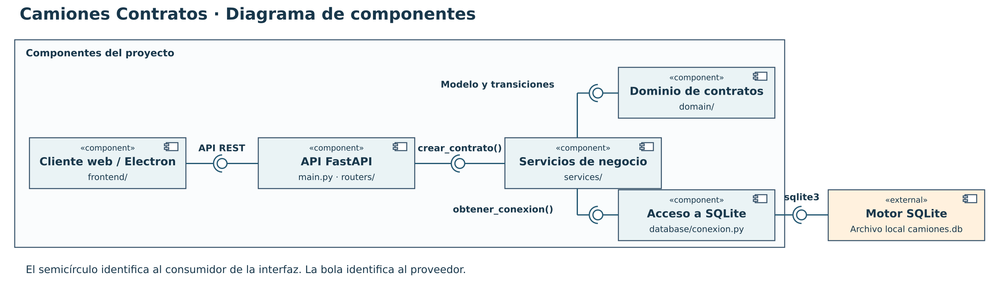

# Diagrama de componentes de Camiones Contratos

[Fuente editable en diagrams.net](4-componentes.drawio)

## Nota de lectura

El cliente usa HTTP y JSON para que las vistas puedan consumir la misma API desde Electron o desde el navegador.  
FastAPI reúne las rutas de autenticación, configuración, contratos, onboarding y subastas en una sola aplicación.  
La creación de un contrato ilustra la división de responsabilidades entre la API, los servicios y el dominio.  
El router delega en ServicioContrato, que utiliza los modelos y las reglas de transición para operar sobre el contrato.  
El módulo de conexión centraliza la apertura de SQLite y permite que las operaciones compartan una transacción cuando lo necesitan.  
SQLite figura como motor externo al código propio, integrado en el proceso del backend, y conserva los datos en camiones.db por defecto.

En cada enlace, el semicírculo pertenece al componente que requiere la interfaz y la bola al que la provee. Por ejemplo, el router requiere la operación `crear_contrato()` y el servicio de contratos la provee.

## Correspondencia con el código

| Interfaz del diagrama | Evidencia en la implementación |
| --- | --- |
| API REST | [Cliente de login](../../frontend/src/paginas/login/login.js) y [registro de routers](../../backend/app/main.py). |
| ServicioContrato.crear_contrato | [El router recibe ContratoCrear y delega la creación](../../backend/app/modules/contratos/router.py). |
| Modelo y transiciones (ContratoModelo y MaquinaEstadosContrato) | [El servicio trabaja con el modelo y la máquina de estados](../../backend/app/modules/contratos/service.py). |
| obtener_conexion() | [El servicio importa el acceso a datos](../../backend/app/modules/contratos/service.py). |
| sqlite3 | [Apertura de la base, inicialización del esquema y ruta por defecto](../../backend/app/db/conexion.py). |
