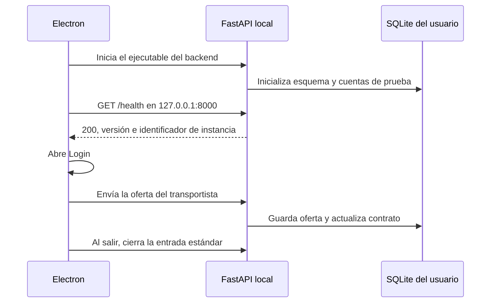

# Cómo entregamos MansoViaje como aplicación de escritorio

**Guion para el Hito 3 de ISF224 · 6 minutos · versión 1.0.0**

## 1. Qué recibe el docente · 40 s

**Mostrar:** la publicación de GitHub y el archivo `MansoViaje-1.0.0-win-x64.exe`.

Antes, quien evaluaba el proyecto preparaba Python y Node.js, instalaba las dependencias y arrancaba la API y la interfaz. Para la entrega elegimos un instalador por usuario que incluye ambos subsistemas. GitHub distribuye el archivo. Una vez instalado, el equipo del docente ejecuta la aplicación y guarda sus datos localmente. La contrapartida es que esta distribución se construyó para Windows x64. [Release v1.0.0](https://github.com/hamburgetestudent/Camiones_contratos/releases/tag/v1.0.0)

## 2. Del commit al instalador · 1 min

1. Partimos del commit `37c73ac`, identificado por la etiqueta `v1.0.0`. Instalamos las dependencias de construcción desde el lock de Python y el lockfile de npm.
2. PyInstaller reunió el intérprete de Python, FastAPI, Uvicorn y el esquema SQL en un directorio ejecutable. Así, la API puede iniciarse en el equipo del docente sin instalar Python aparte.
3. Compilamos el proceso principal de Electron y copiamos las vistas HTML, CSS y JavaScript. Con `extraResources`, electron-builder incorporó el directorio del backend y la documentación. NSIS generó el instalador.
4. Publicamos el archivo con su suma SHA-256. Tras descargarlo desde GitHub, comprobamos que coincidía con el instalador probado. Dentro de la instalación, `resources/entrega/VERSION.txt` identifica el commit y `fuentes.zip` permite continuar el desarrollo. [Script de construcción](../scripts/construir-entrega.ps1) · [Configuración de electron-builder](../frontend/electron-builder.yml)

## 3. Qué ocurre al abrir y cerrar MansoViaje · 1 min

Electron verifica la identidad del backend antes de mostrar Login. Esto importa si otro programa ocupa el puerto 8000. El esquema forma parte de la instalación, mientras que `camiones.db` se crea en una carpeta escribible del usuario. Al cerrar la aplicación se libera el puerto. Al volver a abrirla se recupera la misma base. [Proceso principal](https://github.com/hamburgetestudent/Camiones_contratos/blob/v1.0.0/frontend/codigos/main.ts) · [Control del backend](https://github.com/hamburgetestudent/Camiones_contratos/blob/v1.0.0/frontend/codigos/backend.ts)

## 4. Demostración de una postulación · 2 min

**Preparación:** instalar el archivo publicado y dejar libre el puerto 8000. Para ajustar la demostración a dos minutos, preparar el contrato de prueba antes de exponer. El README contiene las cuentas ficticias y los pasos para repetir el recorrido desde cero. [README de la versión entregada](https://github.com/hamburgetestudent/Camiones_contratos/blob/v1.0.0/README.md)

| Acción en pantalla | Resultado que debe ver el público |
|---|---|
| Como dador aprobado, mostrar la carga Valparaíso–Concepción que se creó y publicó. Anotar su ID. | El contrato figura como `PUBLICADO`. |
| Como transportista aprobado, abrir esa carga e intentar ofertar 4.900 CLP. | El formulario exige al menos 5.000 CLP y permite corregir el importe. |
| Ofertar 180.000 CLP, indicar las horas y enviar. | Electron confirma la postulación. |
| Cerrar y abrir MansoViaje. Entrar como dador y elegir **Gestión de Subastas y Adjudicación → Revisar ofertas**. | El mismo contrato está `EN_POSTULACION` y muestra una oferta `POSTULADA` por 180.000 CLP. |

## 5. Qué descubrimos al probar la entrega · 1 min

La primera construcción en una carpeta limpia se detuvo al reunir los avisos de licencia. Electron 44 descarga su runtime bajo demanda y en ese momento faltaba el archivo de avisos de Chromium. Corregimos el script para descargar el runtime explícitamente y repetimos la construcción desde otra copia limpia.

Después instalamos el archivo final en Windows 10 Pro x64 y probamos la interfaz con un perfil nuevo. Además del caso válido, verificamos el rechazo HTTP 422 con un envío controlado de 4.900 CLP y comprobamos que la carga conservaba su estado y seguía sin ofertas. También ocupamos el puerto 8000: Electron mostró el error y, al liberar el puerto y pulsar **Reintentar**, recuperó la misma oferta. [Acta de aceptación](aceptacion-escritorio-1.0.0.md)

## 6. Cierre ante la rúbrica · 20 s

**Mostrar:** la etiqueta, el README, el acta y la ficha externa. La suite del commit de entrega pasó 229 pruebas y 76 subpruebas, con 93,4 % de cobertura en las capas Python medidas. La aceptación del instalador comprobó por separado la interacción entre Electron, FastAPI y SQLite. Para completar el criterio 7 queda que una persona de otro equipo siga el README, ejecute el flujo, localice el punto de extensión y registre sus dificultades. [CI de la entrega](https://github.com/hamburgetestudent/Camiones_contratos/actions/runs/45712407504) · [Ficha de revisión externa](revision-externa.md)
